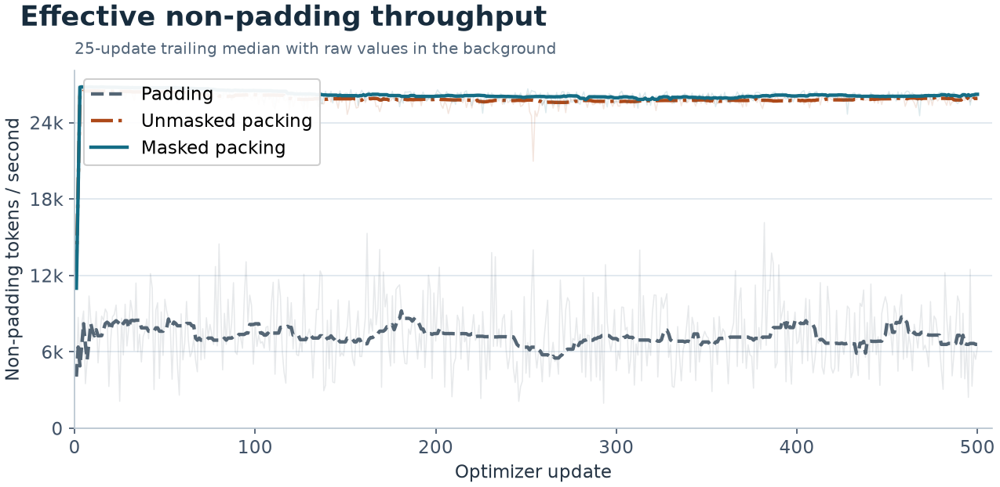
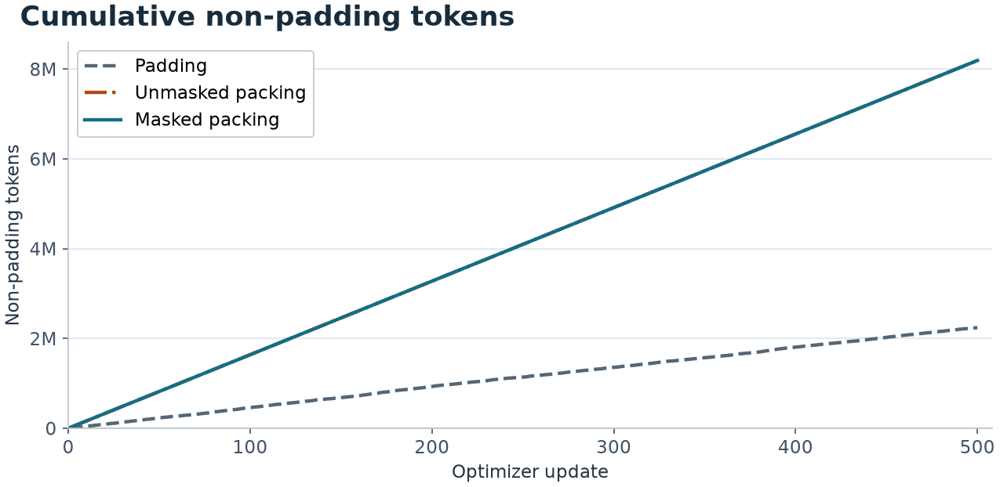
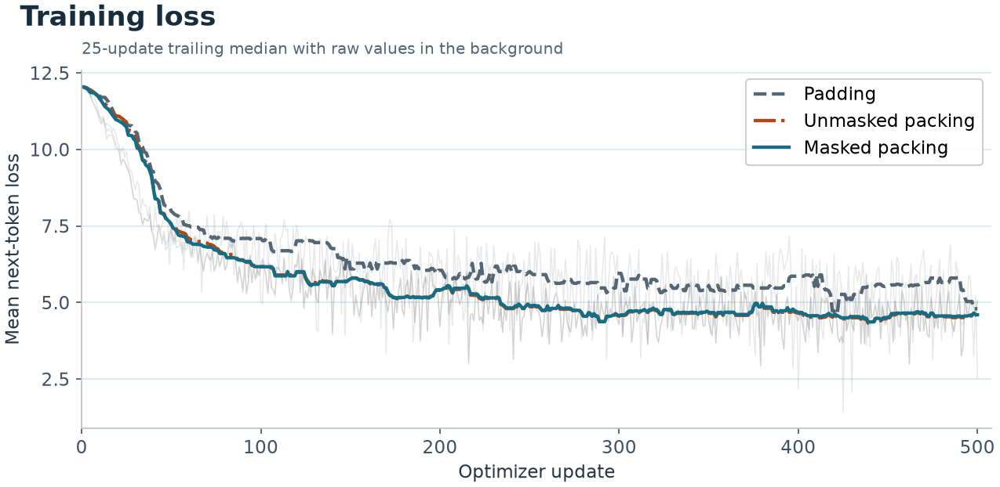
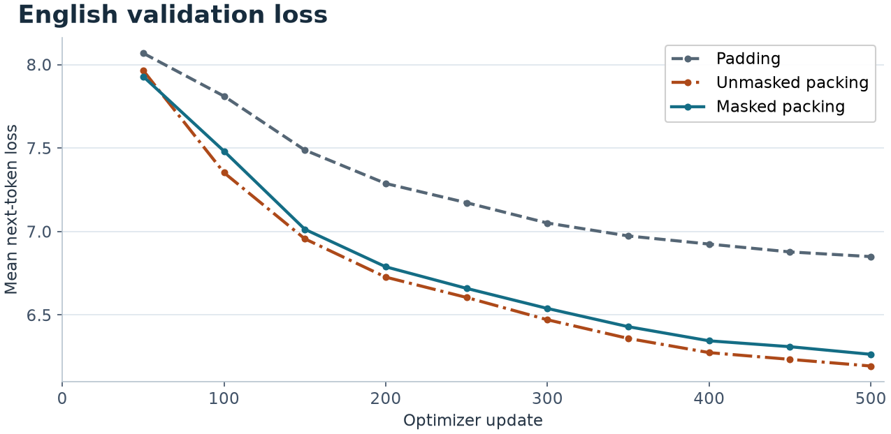
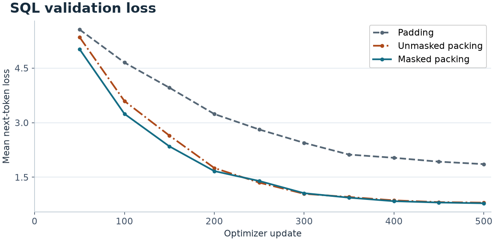

# Sequence packing takeaways

Three single-A10 runs compared **padding**, **unmasked packing**, and **masked packing**. Each ran for 500 optimizer updates with seed 42, context length 2,048, four rows per microbatch, and two microbatches per update. Unmasked packing lets tokens attend to earlier documents in the same row. Masked packing resets positions and restricts attention and next-token targets to each document.

| Method | Median non-padding tokens/sec, updates 51–500 | Non-padding tokens seen | Final English validation loss | Final SQL validation loss |
| --- | ---: | ---: | ---: | ---: |
| [Padding](https://forge.coreweave.com/wandb/dkbsingh7-iit-delhi/sqlgen-day5/runs/fc6405f5e7e942d891b48e252d42f862) | 7,115 | 2.24M | 6.850 | 1.861 |
| [Unmasked packing](https://forge.coreweave.com/wandb/dkbsingh7-iit-delhi/sqlgen-day5/runs/cf71dfdbdb944981bdb146222ec884ff) | 25,811 | 8.19M | 6.194 | 0.802 |
| [Masked packing](https://forge.coreweave.com/wandb/dkbsingh7-iit-delhi/sqlgen-day5/runs/9803edfba7e04d539b9fd75588042232) | 26,104 | 8.19M | 6.264 | 0.786 |

The validation curves come from the original runs. The original train and validation sets had overlap, so these losses describe that experiment and should not be used as evidence of generalization to the new split.

## Effective non-padding throughput

Both packing methods processed about **3.6× as many non-padding tokens per second** as padding. Masking document boundaries had little observed throughput cost in this run.

## Cumulative non-padding tokens

Both packing methods saw **8.19M** non-padding tokens, and padding saw **2.24M**. The equal-update comparison therefore includes about **3.65× more training tokens** for packing. It leaves open how the methods compare at equal token budgets.

## Training loss

The training curves describe next-token prediction on each method's own sampled batches. Packing changes how many documents and tokens contribute to an update, and masking also changes the attention context and which targets count at document boundaries. Compare the validation curves alongside training loss.

## English validation loss

Unmasked packing ended slightly below masked packing on the original English validation sample. Both packed runs saw the same number of non-padding tokens. With one seed per method, the size and consistency of the difference remain uncertain.

## SQL validation loss

Masked and unmasked packing finished close together on the original SQL evaluation. The larger gap between padding and packing combines the different token budgets with the effects of the batching methods.

