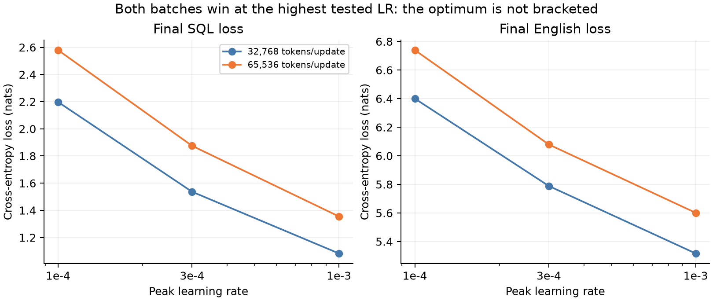
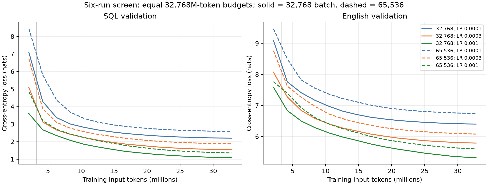

# Batch size × learning rate: six-run screening results

**The best tested setting was batch 32,768 with peak LR `1e-3`: SQL validation
loss 1.082814 and English validation loss 5.316530.** At every tested LR, doubling
the batch to 65,536 worsened both final losses. Raising LR improved both batches
throughout the tested range, so we found a useful candidate, not an optimal LR
or a critical batch size.

This was a **quarter-budget screen**, completed on 2026-11-24. All six runs used
32.768M training input tokens. No further training was launched for this analysis.

## Question

At fixed training tokens, does a larger batch learn as effectively when it makes
fewer optimizer updates? Does changing LR alter that comparison enough that
comparing batches at only one LR would be misleading?

These are two different decisions: choose a reasonable LR *within* each batch,
then compare the resulting recipes *across* batches. A loss at an untuned LR is
not a complete assessment of that batch size.

## Prediction, recorded before launch

- `1e-4` might learn slowly; larger LR might make faster progress with more risk
  of instability.
- Doubling the batch might require a higher LR to compensate for fewer updates.
- A short screen might identify candidates worth a longer run. It would not
  locate a critical-batch knee from only two batch sizes.

The results support the slow-low-LR prediction. They did not reveal instability
at the tested high LR. Whether the best LR shifts with batch remains unresolved:
both winners sit at the upper boundary of the LR grid.

## Controlled settings

| Setting | Batch 32,768 | Batch 65,536 |
| --- | ---: | ---: |
| Context length | 4,096 | 4,096 |
| Hardware microbatch, sequences | 4 | 4 |
| Gradient accumulation | 2 | 4 |
| Optimizer updates | 1,000 | 500 |
| Warmup updates | 100 | 50 |
| Warmup input tokens | 3,276,800 | 3,276,800 |
| Total training input tokens | 32,768,000 | 32,768,000 |
| Valid prediction targets, measured | 32,736,263 | 32,736,263 |
| Peak LRs tested | `1e-4`, `3e-4`, `1e-3` | `1e-4`, `3e-4`, `1e-3` |

Each case consumed 2,000 microbatches. Accumulation changed how those microbatches
were grouped into updates; it did not change the total token budget. This is one
quarter of the preceding schedule experiment's 131.072M tokens per run.

All runs used the same 34,478,592-parameter dense Transformer: 6 layers, width
512, FFN 1408, GQA with 8 query/4 KV heads, QK normalization off, normal weight
initialization std 0.02, masked document packing, BF16 compute and FP32 parameters.
Optimizer: AdamW, betas `(0.9, 0.95)`, weight decay 0.1, gradient clip norm 1.
Cosine decay followed 10% warmup and ended at 0.1 × each peak LR. The LR trajectory
matched across batches when indexed by training tokens, not by update number.

Training seed was 1. Validation seed was 12345, using the same 128 standalone
documents per corpus at each evaluation. Evaluation occurred every 2,097,152
training tokens plus the final budget: **16 SQL and 16 English observations per
run**. Validation did not advance the training sampler or update weights.

The historical SQL sampling probability remained 0.5 **by document**. Measured
training token share was **62.8345% SQL and 37.1655% English**, identical across
all cases. This did not implement the pasted curriculum's provisional 50/50 mix
by tokens; mixture was held fixed to keep the batch/LR screen comparable.

## Sanity checks before interpreting loss

All six saved results passed the existing `analyze()` checks: planned config and
common dataset identity, contiguous finite histories, matching validation-token
coordinates, and the exact final input-token budget. W&B reports all six training
runs and the comparison run as finished. Saved tracking checks confirm uploaded
scalar histories and all four per-run chart tables.

Every case had exactly 32,736,263 valid prediction targets. For each paired LR,
each large-batch update's target count and SQL-token count matched the sum of the
corresponding two small-batch updates. This is useful evidence that changing
accumulation preserved data exposure. These count checks do not prove GPU
arithmetic is bit-identical or compare every sampled token ID.

The six warmup, midpoint and final checkpoint sets exist on the Volume. The two
16,384-batch runs from the cancelled, incorrectly budgeted submission were
excluded; their W&B records were subsequently deleted. They are not two extra
observations in this screen.

## Measured results

Loss is token-weighted next-token cross-entropy in nats; lower is better. Every
entry below is from the **final matched-budget checkpoint**, not a cherry-picked
earlier minimum. Both validation series decreased at all 16 sampled points in
every run, so each final value was also that run's best observed value.

| Batch tokens/update | Peak LR | Final SQL loss | Final English loss | Status |
| ---: | ---: | ---: | ---: | --- |
| 32,768 | `1e-4` | 2.197655 | 6.400445 | Completed |
| 32,768 | `3e-4` | 1.536814 | 5.788605 | Completed |
| **32,768** | **`1e-3`** | **1.082814** | **5.316530** | **Completed** |
| 65,536 | `1e-4` | 2.579615 | 6.739925 | Completed |
| 65,536 | `3e-4` | 1.875033 | 6.079098 | Completed |
| 65,536 | `1e-3` | 1.355279 | 5.601100 | Completed |



### What the LR sweep established

Within batch 32,768, moving from `1e-4` to `3e-4` lowered SQL loss by 0.660841;
moving from `3e-4` to `1e-3` lowered it by another 0.454001. The corresponding
improvements for batch 65,536 were 0.704583 and 0.519753. English loss improved
in the same order, so the SQL winner did not trade away English performance
among these six choices.

There is **no U-shaped LR curve** in this grid. Loss kept improving toward its
right-hand edge. It is reasonable to retain `1e-3` as the best tested candidate;
it is not reasonable to label it the optimal LR or infer where instability begins.

### What doubling the batch established

The table reports larger-batch minus smaller-batch loss at the same LR. Positive
means the larger batch was worse.

| Peak LR | SQL loss difference | English loss difference |
| --- | ---: | ---: |
| `1e-4` | +0.381960 | +0.339479 |
| `3e-4` | +0.338218 | +0.290493 |
| `1e-3` | +0.272466 | +0.284571 |

The smaller batch won **all 16 shared validation checkpoints for each LR, in
both corpora**. This was a persistent trajectory difference, not just an unusual
last evaluation. At the best tested LR for each batch, the SQL gap was 0.272466
and the English gap was 0.284571.

LR choice still matters: batch 65,536 at `1e-3` beat batch 32,768 at `3e-4` by
0.181535 SQL loss and 0.187504 English loss. An inadequately tuned smaller batch
can lose to a better-tuned larger one. However, the larger batch never won a
same-LR comparison here, and the best tested LR did not shift. This is not evidence
that a higher LR has already fully compensated for halving the updates.



## Explanation: what is plausible, and what was measured?

**Measured:** the large batch averaged more targets before each update but made
only 500 updates to the small batch's 1,000. Both saw the same total inputs and
targets. **Plausible explanation:** more frequent parameter updates helped the
smaller batch use this short training horizon more effectively. Raising LR helped
the larger batch, and its SQL penalty narrowed across the tested range. We did
not isolate update frequency from all optimizer effects, so this is an explanation
to test rather than a proven mechanism.

Adam's moments are updated once per optimizer step. Keeping betas fixed therefore
changes their effective memory in *tokens* when batch size changes. AdamW's total
decay also changes: the decay-only multiplier `product(1 - lr_t * weight_decay)`
at peak `1e-3` is 0.946952 for batch 32,768 versus 0.973112 for batch 65,536. That
calculation describes the shrinkage component on decayed matrices, not the actual
change of trained weights. These were comparisons of practical recipes with fixed
betas/decay, not a pure measurement of gradient-noise reduction.

The validation curves dropped quickly early, then flattened as training progressed
and cosine reduced LR. This is consistent with learning easier regularities first
and making smaller later updates. It does not establish convergence or a data/model
loss floor: training exposure and LR changed together, and this was a short screen.

### Gradient clipping and the noise question

The logged norm is measured **before clipping**, after accumulation. Clipping
fraction is the number of updates above norm 1 divided by that run's update count.

| Batch | Peak LR | Median pre-clip norm | Maximum norm | Updates clipped |
| ---: | ---: | ---: | ---: | ---: |
| 32,768 | `1e-4` | 1.180 | 7.950 | 87.1% |
| 32,768 | `3e-4` | 0.803 | 7.924 | 24.8% |
| 32,768 | `1e-3` | 0.505 | 8.252 | 10.6% |
| 65,536 | `1e-4` | 1.098 | 8.416 | 66.2% |
| 65,536 | `3e-4` | 0.776 | 8.541 | 22.2% |
| 65,536 | `1e-3` | 0.479 | 14.428 | 11.8% |

The best tested LR did not have the highest typical gradient norm or most frequent
clipping. A plausible reason is that it learned more quickly and subsequently
reached lower-loss states. The maximum 14.428 occurred at update 20 in the
65,536/`1e-3` run, but that run still completed with decreasing sampled validation
loss. An isolated large norm is not enough to declare divergence.

Clipping bounds the gradient supplied to AdamW. It does not remove directional
noise or directly bound the adaptive parameter update. Conversely, fewer clipped
updates do not prove a flatter loss landscape. Curvature, update-to-weight ratios
and gradient-noise scale were not measured here. No claim about an edge of
stability follows from these norms alone.

Training-loss jaggedness is also expected from changing document difficulty and
SQL/English composition. The validation set is fixed and averaged over 128
documents per corpus; training loss averages the current update's different
examples. Their absolute levels and short-term fluctuations are not directly
comparable measures of generalization.

## Time efficiency

Reconstructing training-update time from `batch_tokens / tokens_per_second`
gives **8.16–8.34 minutes per run**, excluding validation, checkpoint IO and W&B.
The small-batch mean was 8.280 minutes; the large-batch mean was 8.189 minutes:
only about a 1.1% reduction, not a 2× speedup. Both still processed the same
2,000 hardware microbatches; accumulation mostly saved optimizer-step overhead.

W&B's recorded SDK lifetimes were 681–701 seconds (11.35–11.68 minutes) per
training run. Those include surrounding work while tracking was active, but
exclude some container startup and are not a billing export. The six update-time
estimates total 49.41 GPU-minutes; SDK lifetimes total 69.28 minutes across workers.
Parallelism reduced elapsed waiting time, not aggregate compute. No exact invoice
cost is asserted from these timings. Peak allocated training VRAM was about
3.55 GiB in all runs; increasing effective batch by accumulation did not double it.

## Limitations and the decision this supports

- **One training seed per cell.** There is no seed mean, sample standard deviation
  or significance estimate to report. Do not substitute variation across LRs,
  validation checkpoints or the earlier schedule experiment for matched seed noise.
- **The upper LR boundary won.** The larger batch may need a higher LR than this
  grid provides. We have not established its best achievable loss or that it lies
  beyond a critical batch size.
- **Quarter horizon and compressed schedule.** These runs decayed to minimum LR
  at 32.768M tokens. Continuing their final checkpoints is not the same experiment
  as training fresh with a 131.072M-token schedule from the start. Winners can change
  with horizon; do not compare these finals directly with Day 7 finals at 4× tokens.
- **Small, reused validation samples.** They support consistent loss comparisons,
  but repeated tuning can overfit the selection set. Held-out-schema SQL execution
  accuracy has not been measured, and loss improvements are not accuracy percentages.
- **Mechanisms were not isolated.** Optimizer memory, decay and clipping change
  alongside update frequency. No curvature or critical-noise-scale measurement
  was made. Monotone sampled validation can also miss between-evaluation spikes.

**Decision:** keep batch 32,768 / peak LR `1e-3` as the current screening candidate.
There is no observed quality or material throughput advantage that justifies
switching to batch 65,536 within this tested grid. Keep its best checkpoint as a
credible alternative rather than discarding it as universally inferior.

## Next experiment

The first unresolved issue is the LR boundary. If more screening compute is
available, test **one adjacent higher LR, such as `3e-3`, at both batches** with
the same quarter budget, stream and token-based schedule. The comparison would
ask whether the curves turn upward and whether the large-batch gap narrows or
reverses. These two trials are a proposal; they have not been launched.

Then confirm promising recipes at the intended full horizon from fresh
initializations with the full-horizon schedule, and replicate across matched
seeds before claiming a reliable gain. If compute is especially limited, retain
the current candidate provisionally and spend confirmation compute on its most
credible challenger. Do not buy the old 16-cell grid just to force a textbook knee.

## Saved states for later lessons

Artifacts remain in the existing experiment folder on the Modal Volume:

```text
/vol/checkpoints/pretraining_experiments/batch_lr_scaling/batch-lr-bfd9633ebee9/
  plan.json
  checkpoint_index.json
  analysis.json
  summary.json
  <case>/
    settings.json
    metrics.jsonl
    result.json
    tracking-check.json
    latest.pt
    step-<warmup>.pt
    step-<midpoint>.pt
    step-<final>.pt
```

Snapshots are at updates **100 / 500 / 1000** for batch 32,768 and **50 / 250 /
500** for batch 65,536. Those correspond to the same 3.2768M / 16.384M / 32.768M
tokens. Each snapshot is approximately 414 MB and includes model/optimizer state,
architecture/config, sampler and CPU/CUDA RNG state, token count and committed
history. `latest.pt` duplicates the final state on completion and served as a
recovery snapshot during training.

The checkpoint index stores the fixed validation recipe. It can be reused for
later curvature probes or controlled continuations with the same corpus and
tokenizer. Ordinary resume requires unchanged settings; changed-LR branches need
explicit support. No recent parameter-update vector was saved, so a later probe
must reconstruct a direction. Checkpoint preservation did not itself run those
future experiments.

## Evidence and reproduction

Suite: `batch-lr-bfd9633ebee9`. The current report was recomputed from the saved
six `result.json` histories, independently checked against the suite analysis,
and cross-checked with W&B completion and the Volume checkpoint inventory.

- [Numeric analysis, sanity checks and checkpoint index](analysis.json)
- [All 96 validation observations](validation_results.csv)
- [Per-run clipping, timing and token diagnostics](run_diagnostics.csv)
- [W&B comparison plots](https://forge.coreweave.com/wandb/dkbsingh7-iit-delhi/sqlgen-batch-lr-scaling/runs/6zswayk3)
- [Modal training app](https://modal.com/apps/sanika-05/main/ap-5LpidJvqZ9wu8nMfKAiCv1)

| Batch | LR | W&B source |
| ---: | --- | --- |
| 32,768 | `1e-4` | [Run](https://forge.coreweave.com/wandb/dkbsingh7-iit-delhi/sqlgen-batch-lr-scaling/runs/1a6ce5c5f9384831b7a181f80a1a5f4c) |
| 32,768 | `3e-4` | [Run](https://forge.coreweave.com/wandb/dkbsingh7-iit-delhi/sqlgen-batch-lr-scaling/runs/f8a7476d82c443308207159bc7ff8296) |
| 32,768 | `1e-3` | [Run](https://forge.coreweave.com/wandb/dkbsingh7-iit-delhi/sqlgen-batch-lr-scaling/runs/77826f90066344cbbe747e0cef911548) |
| 65,536 | `1e-4` | [Run](https://forge.coreweave.com/wandb/dkbsingh7-iit-delhi/sqlgen-batch-lr-scaling/runs/3afc988550c14c3fbac8cb9ab11a345e) |
| 65,536 | `3e-4` | [Run](https://forge.coreweave.com/wandb/dkbsingh7-iit-delhi/sqlgen-batch-lr-scaling/runs/b192d4cd22d54fd6aacd82a9df51b3e6) |
| 65,536 | `1e-3` | [Run](https://forge.coreweave.com/wandb/dkbsingh7-iit-delhi/sqlgen-batch-lr-scaling/runs/52aee8c6d0d1462094789f252ab14631) |

Dataset corpus ID: `ff43d7752a904b649fad5b2d2dbb4df3`.
Manifest SHA256: `914bb1a0fe4adfc52f474a5f4dccea636b16242ffdc0b2cfa14a02adab54501d`.
Tokenizer SHA256: `05b8bb66ea18f8328e785424de06fd6653c9147a7dbe686a4dd1627e224e85a1`.
All cases used the same completed flat-layout dataset at
`/vol/bpe_tokenization/pretrain_data` and vocabulary size 32,768.
The [execution guide](README.md) documents commands and the shared training engine.

## Follow-up: SGD at the shared batch

The completed [SGD stability report](../sgd_stability/takeaways.md) compares the
same batch 32,768 and 32.768M-token horizon. SGD's best tested peak LR was 0.1,
with SQL/English losses 4.880735 / 8.094679, versus AdamW's 1.082814 / 5.316530
at peak 0.001. The report documents a higher-LR penalty and large fixed-probe
fluctuations in SGD. It also explains why near-continuous clipping and much
stronger cumulative decay limit an optimizer-only interpretation. Only the
shared batch is a matched optimizer comparison; neither LR search proves an
exact optimum. No fixed training-probe curve was recorded for these AdamW runs.
