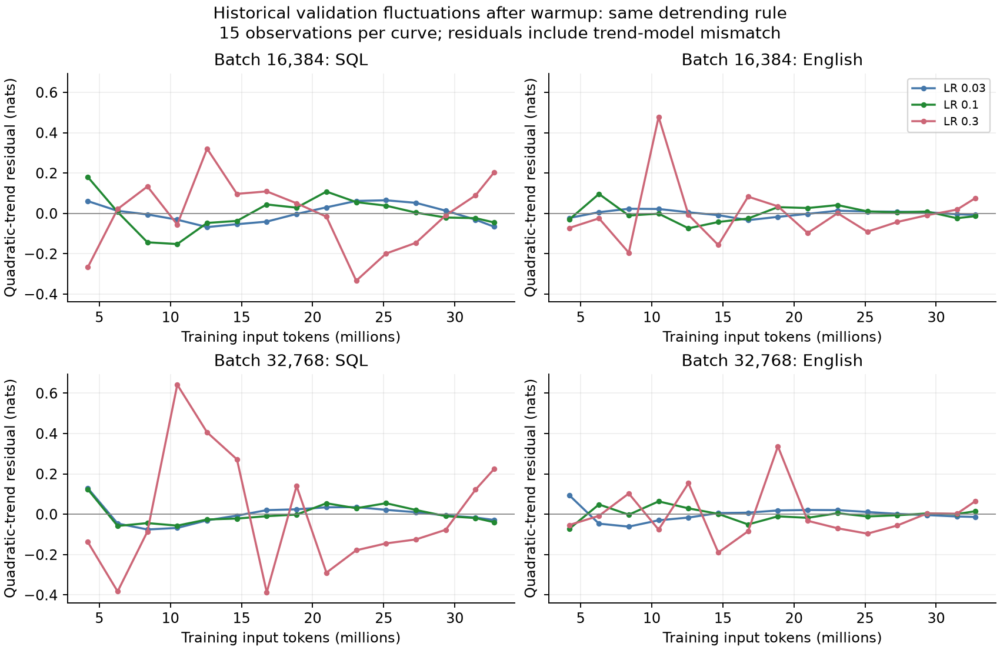
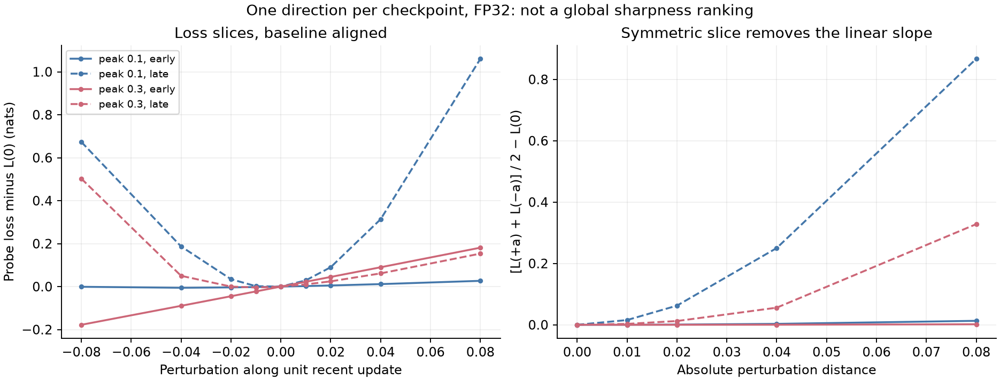
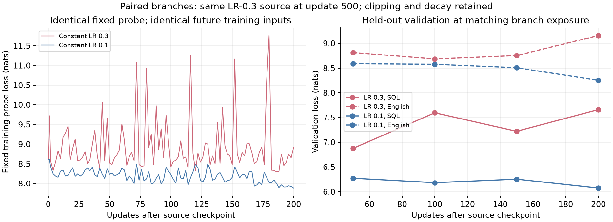
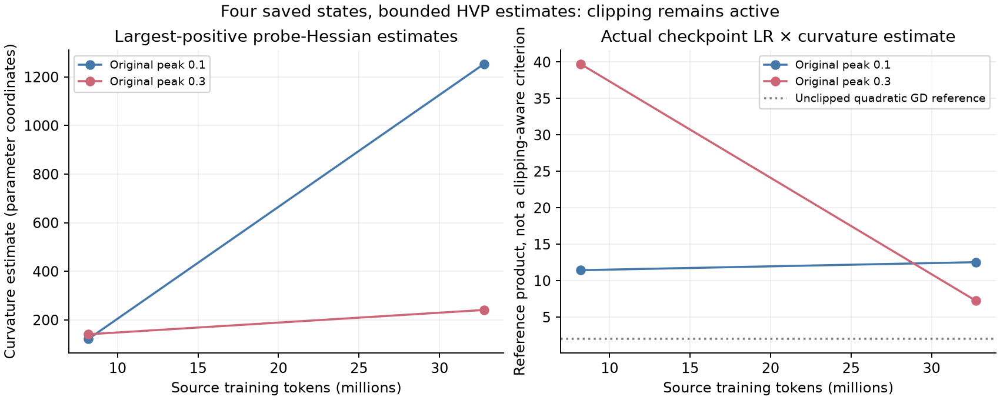

# Loss landscape and checkpoint branching: measured takeaways

**Reducing constant LR from 0.3 to 0.1 at the same saved SGD state reduced
fixed-probe fluctuations and improved both final validation losses.** The two
arms consumed hash-identical future training inputs for all 200 updates. This is
controlled evidence of local LR sensitivity, with clipping and decay retained.

**It is not an edge-of-stability demonstration.** Directional and Hessian
measurements describe a small, English-heavy probe. Their relation to the
actual clipped/decayed stochastic update is more complicated than the textbook
unclipped-GD `eta × lambda = 2` reference.

All four requested parts are complete: historical detrending, four directional
slices, two constant-LR branches, and bounded Hessian estimates. No clipping
frequency was calculated or reported in this investigation. Gradient clipping
remained **1.0**, as clarified by the user.

## Question and prediction

The source SGD sweep showed large fluctuations at peak LR 0.3. We asked whether
lowering LR at the *same state*, on the *same future data*, would suppress those
fluctuations. We also asked whether the noisy run occupied sharper directions
or had larger maximum probe curvature than the better-performing LR-0.1 run.

Before measurement, the prediction was that a lower-LR branch would fluctuate
less. We did not predict that the high-LR states must be sharper: both outcomes
were plausible. A loss wiggle, a directional slice and a Hessian reference are
three different observations; none substitutes for the others.

## Controlled settings and saved-state selection

Source suite: `sgd-stability-87b9a2c0cec8`. Fix batch **16,384** for all new GPU
measurements. Keep context 4096, microbatch 4, plain SGD without momentum,
**decoupled weight decay 0.1**, clipping 1.0 and the original model/data settings.

The four diagnostic checkpoints were:

| Original peak LR | Phase | Source update | Input tokens | Actual LR at saved update |
| ---: | --- | ---: | ---: | ---: |
| 0.1 | Early | 500 | 8,192,000 | 0.093971 |
| 0.1 | Late | 2,000 | 32,768,000 | 0.010000 |
| 0.3 | Early | 500 | 8,192,000 | 0.281913 |
| 0.3 | Late | 2,000 | 32,768,000 | 0.030000 |

“Peak LR” identifies the source run; its cosine schedule means the LR actually
applied at a checkpoint is different. The reference curvature products below
use the actual LR, not the peak label.

The fixed probe is the exact saved pair of training documents: **1,255 English
prediction targets and 77 SQL targets**, so its token-weighted loss is **94.22%
English**. It is useful for consistent local observations, but is neither a
representative whole-corpus objective nor a held-out validation set.

## 1. Quantifying the historical fluctuations without new training

For each source run, fit a quadratic trend against normalized training-token
coordinates and report the **sample SD of residuals, ddof=1**. The primary window
excludes warmup and contains 15 validation observations. Linear detrending is a
sensitivity check; a late-half fit uses 9 observations. These are descriptive
scores, not seed uncertainty or a statistical oscillation detector.

| Batch | Original peak LR | Final SQL loss | SQL residual SD | English residual SD |
| ---: | ---: | ---: | ---: | ---: |
| 16,384 | 0.03 | 5.362884 | 0.047213 | 0.015861 |
| 16,384 | 0.1 | 4.686303 | 0.085308 | 0.040157 |
| 16,384 | 0.3 | 5.437961 | **0.177571** | **0.153760** |
| 32,768 | 0.03 | 5.758083 | 0.050151 | 0.035733 |
| 32,768 | 0.1 | 4.880735 | 0.049438 | 0.033774 |
| 32,768 | 0.3 | 5.411802 | **0.294801** | **0.125826** |



LR 0.3 has the largest post-warmup score in both corpora at both batches under
both quadratic and linear detrending. The broad high-LR disturbance is robust
to those two choices. Low-versus-middle LR rankings are less robust: for batch
16,384 SQL, linear detrending gives 0.166591 at LR 0.03 versus 0.157611 at 0.1,
reversing the quadratic-score order. Smooth learning-curve shape is part of a
residual score when the fitted trend is imperfect.

Late-half scores usually fall, but **not uniformly**. At batch 32,768/LR 0.3,
English residual SD is 0.126310 in the late half versus 0.125826 in the primary
window. At batch 16,384/LR 0.3, SQL falls from 0.177571 to 0.072196. Different
window lengths and separately fitted trends limit a direct ratio comparison.
The per-update fixed probe and the controlled branches are more informative
about rapid local changes than these sparse validation scores alone.

## 2. Directional loss slices: what “sharper” means here

For each checkpoint, normalize its saved actual arriving update:

```text
d = last_parameter_change / ||last_parameter_change||
f(alpha) = fixed_probe_loss(theta + alpha*d)
kappa(epsilon) = [f(+epsilon) + f(-epsilon) - 2*f(0)] / epsilon²
```

Evaluate alpha 0, ±0.01, ±0.02, ±0.04 and ±0.08. These are absolute distances
along a whole-parameter unit vector. No optimizer update is taken, and original
weights are restored after the slice. Loss is evaluated in **FP32 with TF32
disabled**, using differentiable math attention on the unpadded real documents.
The training backend/precision are unchanged. This avoids attributing small
BF16 loss differences to curvature.

| Source checkpoint | Curvature at epsilon 0.01 | At epsilon 0.02 | Relative disagreement |
| --- | ---: | ---: | ---: |
| Peak 0.1, early | 3.776550 | 3.788471 | 0.31% |
| Peak 0.1, late | 309.448242 | 312.150717 | 0.87% |
| Peak 0.3, early | 0.247955 | 0.262260 | 5.45% |
| Peak 0.3, late | 59.409142 | 61.451197 | 3.32% |



The high-LR source states have **lower curvature along their own recent update
directions** at both exposures. Thus a more fluctuating trajectory did not imply
higher curvature along the measured direction. The symmetric panel cancels the
local linear slope; baseline alignment alone would not remove that slope.

Both runs have much higher late directional curvature than early curvature.
Training progress, changing LR and changing parameter scales/decay all differ
between those states; this is not evidence that decay alone caused sharpening.
The four directions are also different. This is a coordinate/direction-specific
comparison, not a global loss-landscape ranking. The 5.45% epsilon disagreement
in the small early-0.3 estimate is a useful warning against overinterpreting
its final decimal places; two perturbation sizes do not prove asymptotic accuracy.

## 3. Controlled constant-LR checkpoint branching

Both arms started at the **same peak-0.3 source checkpoint, update 500**, with
8.192M input tokens already consumed. Each restored identical weights, optimizer
state, sampler and CPU/CUDA RNG state. Each then trained for **200 updates**,
adding 3.2768M input tokens, at constant LR 0.3 or 0.1. There was no new warmup.

The source's current cosine LR was approximately 0.281913. The control therefore
holds the original peak **0.3**, rather than exactly continuing the old cosine
schedule. The intervention holds **0.1**. Clipping, decay, batch and data/loss
controls are identical. Every successful update hashes the actual input IDs,
targets, positions and attention boundaries: **all 200 future-input hashes match**.
Both initial probe losses were exactly **8.611346** in the recorded precision.

Observe the same saved probe at updates 1, 2, 4, …, 200 and perform fixed
SQL/English validation at updates 50, 100, 150 and 200. Fluctuation statistics
use the shared post-update probe coordinates; raw curves and loss levels are
retained rather than replaced with a smoothing-only judgment.

| Metric | Constant LR 0.3 | Constant LR 0.1 |
| --- | ---: | ---: |
| Successful updates | 200 | 200 |
| Initial fixed-probe loss | 8.611346 | 8.611346 |
| Final fixed-probe loss | 8.919600 | **7.881534** |
| Change from initial probe loss | +0.308253 | **−0.729812** |
| Probe RMS successive change | 0.976834 | **0.168434** |
| Quadratically detrended probe SD | 0.675538 | **0.134799** |
| Final SQL validation loss | 7.660782 | **6.072028** |
| Final English validation loss | 9.160039 | **8.252320** |



The lower-LR arm had about **5.8× smaller RMS successive changes** and **5.0×
smaller detrended SD**. The effect appeared early: using the uniform coordinates
0, 2, …, 20, RMS successive change was 0.364141 for the control versus 0.116395
for the intervention, approximately 3.1× smaller. Lower fluctuations were not
simply a stalled model: the lower-LR arm also reduced probe loss and finished
with SQL/English validation losses lower by **1.588755 / 0.907719**.

**Conclusion supported by this intervention:** at this checkpoint and on this
future stream, reducing constant LR improved local behavior and the measured
quality metrics. This is stronger evidence of LR sensitivity than comparing
independent runs at different points in training.

### What the branch does not isolate

With decoupled decay 0.1, the per-step shrink factor on decayed matrices is
**0.97** at LR 0.3 versus **0.99** at LR 0.1. Over 200 steps, the shrinkage-only
multipliers are approximately **0.002261 / 0.133980**. Actual weights also receive
gradient updates, so these are not predictions of final weight norms.

The intervention changes LR's total effect, including shrinkage. It does not
isolate overshooting, minibatch noise or a Hessian mechanism separately. The
branch trajectories also inherit a high-LR-trained state and have a shorter
new horizon; do not compare their final losses directly with the original
fresh-seed full-screen finals. A probe every two updates can miss period-two
behavior. One checkpoint and one future sample stream do not establish a
universal or seed-averaged result.

## 4. Probe-Hessian estimates and the edge-of-stability reference

Use exact autograd Hessian-vector products of the FP32, token-weighted fixed
probe loss. Twelve power iterations were predeclared per checkpoint. Report
relative residual `||Hv - lambda*v|| / ||Hv||` as a convergence diagnostic.

A numerical trap actually occurred: at the early peak-0.1 state, power iteration
converged to **−1819.714**, the largest-magnitude eigenvalue. Calling that the
largest *positive* curvature would have been wrong. We retained the signed
result and used one bounded **12-step symmetric Lanczos refinement plus one
residual HVP** to estimate the largest algebraic positive value. The original
power evidence is preserved.

| Checkpoint | Largest-positive estimate | Relative residual | Actual LR × estimate |
| --- | ---: | ---: | ---: |
| Peak 0.1, early | 121.686211 | 0.014960 | 11.434992 |
| Peak 0.1, late | 1253.463867 | 0.000020 | 12.534639 |
| Peak 0.3, early | 140.971008 | 0.000020 | 39.741620 |
| Peak 0.3, late | 240.955399 | 0.027497 | 7.228662 |

All residuals are below the declared 5% diagnostic threshold. That supports
using these as bounded numerical estimates, not certificates that the full
training-corpus spectrum is known. Lanczos uses a finite Krylov subspace;
power iteration targets magnitude. The small probe and parameter coordinates
remain important limitations even when an eigenpair residual is small.



The relationship is mixed. Early, the peak-0.3 state's positive estimate is
slightly larger than peak-0.1's, even though its recent-update directional
curvature was smaller. Late, it is much smaller: about 241 versus 1253. This
shows why one directional slice cannot stand in for maximum curvature, and why
“high-LR fluctuations mean a globally sharper region” is not a supported rule.

The raw LR-times-curvature products all exceed 2. **We cannot turn that into an
EoS diagnosis.** The reference comes from unclipped gradient descent on a local
quadratic. Here the update includes clipping, decoupled decay, stochastic data
and a probe Hessian that differs from the training objective. These estimates
exclude the derivative of clipping and the decay update. We did not measure the
Jacobian/spectrum of the actual optimizer map or demonstrate hovering near a
valid stability boundary. The [original full-batch GD study](https://arxiv.org/abs/2103.00065)
provides the reference's scope; our experiment has materially different controls.

## What this investigation established

- **Observation:** high-LR disturbances appear on a fixed training probe and in
  sparse held-out validation, not just in changing-batch training loss.
- **Measurement:** their magnitude depends on the window/detrending choice;
  directional and top-curvature measurements answer different questions.
- **Intervention:** a lower constant LR at a shared saved state, with verified
  future-input equality, reduced fluctuations and improved both validation losses.
- **Theoretical limit:** the raw unclipped-GD reference does not explain our
  clipped, decayed process by itself. We completed the investigation without
  claiming to reproduce every edge-of-stability finding.

## Limitations and next experiment

The fixed probe has only two documents and is English-heavy. Validation has
15 primary/9 late historical points and four branch observations per corpus.
There is one initial seed, checkpoint and future stream for branching, so no
seed mean/sample SD or significance statement is available. No SQL execution
accuracy was measured. Precision/backend choices differ between curvature
probes and training and are recorded explicitly.

A stronger mechanism test would separate LR's gradient-step effect from its
shrinkage effect, repeat another checkpoint/stream, and examine a more representative
probe or the actual optimizer's local dynamics. Those would be separate declared
experiments. There is no need to rerun AdamW merely to complete this lesson.
No additional training is proposed as already executed.

## Artifacts, checks and reproduction

Files stay together in `pretraining_experiments/loss_landscape/`. Source SGD
checkpoints were read-only; branches use isolated output directories and new
W&B IDs. Ordinary resume still enforces unchanged configuration. Explicit
`restore_branch` whitelists only schedule/horizon/evaluation changes, and
checkpointed branch provenance plus input-hash prefixes support resumed work.

- [Analysis and verified chart inventory](analysis.json)
- [Historical fluctuation scores](fluctuation_scores.csv) and [fitted residuals](fluctuations.json)
- [400 branch training rows with sparse probe/validation values](branch_history.csv)
- [Actual paired future-input hashes](paired_input_hashes.json)
- [36 directional loss observations](directional_slices.csv), [8 finite differences](curvature_estimates.csv), and [full diagnostics](diagnostics.json)
- [48 original power-iteration observations](hessian_power_iterations.csv); the negative-case Lanczos spectrum is preserved in diagnostics.
- [Execution/method guide](README.md)
- [W&B comparison](https://forge.coreweave.com/wandb/dkbsingh7-iit-delhi/sqlgen-loss-landscape/runs/gf32bto9)
- [Constant-LR 0.3 branch](https://forge.coreweave.com/wandb/dkbsingh7-iit-delhi/sqlgen-loss-landscape/runs/2ac9d0b3f0a9449eba31df07f5fa8271)
- [Constant-LR 0.1 branch](https://forge.coreweave.com/wandb/dkbsingh7-iit-delhi/sqlgen-loss-landscape/runs/4dbabe6d944f41549ff0418e1e4ad5d2)
- [Primary Modal app](https://modal.com/apps/sanika-05/main/ap-N5A6P7usAtJGb1GrL1HUDJ)

Select W&B's **`hessian/refined_estimates`** and
**`hessian/refined_lr_times_curvature`** for the complete signed-eigenvalue
correction. Original power-only charts are retained as historical partial
estimates. Final API checks verified 36 slice rows, 8 directional estimates,
4 refined Hessian rows, 24 fluctuation-score rows, 202 branch probe rows,
400 training rows and 8 validation rows per metric across the two arms.
These checks verify uploaded data, not browser rendering.

The suite used four original 12-HVP estimates plus 13 HVPs for the negative-case
refinement, and 400 new optimizer updates: **6,553,600 new training input tokens**.
Probe/validation forwards are additional compute. No six-run retraining or AdamW
rerun occurred. The first submission failed during upload and stopped with zero
running tasks; the successful suite is `landscape-bdb9235e3e0e`. Final tests ran
**201 cases, one skipped**, with the rest passing; focused refined-chart tests
also passed.

Volume root:
`/vol/checkpoints/pretraining_experiments/loss_landscape/landscape-bdb9235e3e0e/`.
The source dataset identity remains the same as the completed SGD sweep, recorded
in plan/analysis JSON. The original checkpoints and all new branch full states,
saved probe masks, input fingerprints, precision choices and HVP convergence
records are retained for later review.
