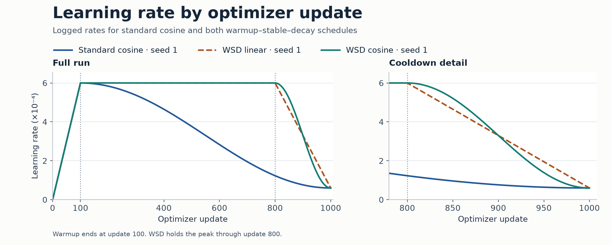
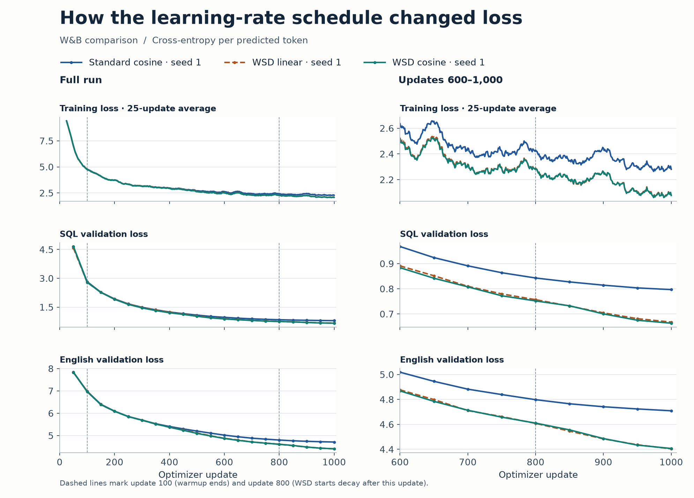

# Seed variation and learning-rate schedules in pretraining

## Why we ran this experiment

A lower validation loss in one run can come from a better training setting or from a favorable
seed. The training seed controls both the initial weights and which documents the model sees.
Repeating standard cosine with different seeds gives us a baseline for how much loss can vary
with the schedule held fixed. We can then judge whether switching schedules produces a gain
large enough to be worth following up.

We compared standard cosine with warmup–stable–decay (WSD) at a fixed training budget. We
expected WSD's higher learning rate might keep validation loss elevated during the stable phase,
with the advantage appearing during cooldown. We also wanted to see whether the shape of that
cooldown mattered.

## What we ran

All five runs used the same 34.48M-parameter model, AdamW optimizer, dataset build, and budget
of 1,000 optimizer updates on one A10 per run. They shared a 100-update warmup to `6e-4` and
finished at `6e-5`. Only the schedule and training seed varied.

| Schedule | Training seeds | Learning rate after warmup |
| --- | --- | --- |
| Standard cosine | 1, 2, 3 | Cosine decay through update 1,000 |
| WSD linear | 1 | Hold `6e-4` through update 800, then decay linearly |
| WSD cosine | 1 | Hold `6e-4` through update 800, then decay along a cosine curve |

The schedules start together. The two WSD variants first differ in their learning rate at
update 801. [W&B comparison](https://forge.coreweave.com/wandb/dkbsingh7-iit-delhi/sqlgen-day7/runs/ap7dswze)

## Sanity checks

1. **Equal training budget.** Masked packing filled all `8 × 4 × 4,096 = 131,072` input slots
   per update. Over 1,000 updates that gives **131,072,000 non-padding input tokens** per run,
   matching the logged counts. The loss uses fewer targets because of the next-token shift and
   the mask at document boundaries.
2. **Correct learning rates.** The logged rates matched the expected warmup, WSD hold, decay
   phases, and final rate when plotted by optimizer update.
3. **Comparable validation.** Each run used the same 128 standalone document draws per corpus
   with validation seed 12345 and evaluated every 50 updates. SQL and English losses were
   computed separately as means over valid prediction targets.
4. **Finite training metrics.** All runs completed 1,000 updates, and the logged training
   losses, validation losses, and gradient norms stayed finite.

## Results and interpretation

### How much did the cosine runs vary across seeds?

The three runs followed similar trajectories. The late-run panels show the spread that remains
when the optimizer, schedule, and validation sample are fixed. In both loss figures, training
traces use a 25-update trailing average and validation markers show the recorded evaluations.

| Standard cosine run | Final SQL loss | Final English loss | Source |
| --- | ---: | ---: | --- |
| Seed 1 | 0.796816 | 4.708972 | [W&B](https://forge.coreweave.com/wandb/dkbsingh7-iit-delhi/sqlgen-day7/runs/822ec9a7a3db46d29f5ba7ae5152746e) |
| Seed 2 | 0.812063 | 4.753372 | [W&B](https://forge.coreweave.com/wandb/dkbsingh7-iit-delhi/sqlgen-day7/runs/d2de060b9c16451189ff44c2bd662fed) |
| Seed 3 | 0.807651 | 4.713550 | [W&B](https://forge.coreweave.com/wandb/dkbsingh7-iit-delhi/sqlgen-day7/runs/ae53e35464c94f38bed3c3b933277621) |
| **Mean (3 seeds)** | **0.805510** | **4.725298** | |
| **Sample standard deviation (3 seeds)** | **0.007846** | **0.024420** | |

The sample standard deviation summarizes how far the three final losses typically sit from
their mean. It was about **0.008 on SQL** and **0.024 on English**. Seed 1 finished with the
lowest loss among the cosine runs on both corpora. Both WSD runs also used seed 1, which
lets us compare schedules while holding the training seed fixed.

### When did the schedules separate?

**Warmup, updates 1–100.** All three schedules used the same learning rates, and both validation
losses fell quickly. At update 100, the seed-1 runs were within 0.034 of each other on SQL and
0.025 on English.

**Early after warmup, updates 101–200.** Standard cosine had only eased to `5.84e-4` by update
200, while WSD was still at `6e-4`. Both WSD runs were slightly ahead of cosine seed 1 on SQL
and English at that point. Cosine seed 2 still had the lowest loss on both. The early order
therefore depended on which cosine run we used as the reference.

**Rest of the stable phase, updates 201–800.** Both WSD runs had lower SQL loss than all three
cosine runs from update 300 onward. The same held for English from update 400. By update 800,
WSD was about **0.09 lower on SQL** and **0.19 lower on English** than cosine seed 1. Cosine had
decayed to `1.23e-4` while WSD still held `6e-4`. The growing lead is consistent with the
higher sustained rate helping the model make more progress over this part of the budget.

**Cooldown, updates 801–1,000.** From update 800 to 1,000, both WSD runs improved by about 0.089
on SQL and 0.204 on English. Cosine seed 1 improved by 0.046 and 0.089, respectively. Cooldown
widened a lead we had expected to emerge during that phase.
All five runs reached their best observed validation losses at the final evaluation.

| Seed-1 schedule | Final SQL loss | Final English loss | Source |
| --- | ---: | ---: | --- |
| Standard cosine | 0.796816 | 4.708972 | [W&B](https://forge.coreweave.com/wandb/dkbsingh7-iit-delhi/sqlgen-day7/runs/822ec9a7a3db46d29f5ba7ae5152746e) |
| WSD linear | 0.667811 | **4.403726** | [W&B](https://forge.coreweave.com/wandb/dkbsingh7-iit-delhi/sqlgen-day7/runs/9d013a624ebf457d9b54feb62540e7f0) |
| WSD cosine | **0.663367** | 4.406684 | [W&B](https://forge.coreweave.com/wandb/dkbsingh7-iit-delhi/sqlgen-day7/runs/6888a42b4d914085abfaf9fef0439e8e) |

Relative to cosine seed 1, the WSD gains were **0.129–0.133 on SQL** and **0.302–0.305 on
English**. Those gains were roughly 16–17 times the measured cosine seed standard deviation on
SQL and 12 times on English. That makes the schedule result worth following up.

The two WSD tails finished close together. Cosine decay finished ahead by 0.0044 on SQL,
while linear decay finished ahead by 0.0030 on English. [Validation observations](validation_results.csv)

## Additional observations

**SQL made up more of the token budget than the document setting suggested.** A
`sql_fraction` of 0.50 gives SQL half the document draws. The sampled SQL documents contributed
more tokens per draw after packing, so SQL accounted for about **62.7% of input tokens** in
each run. SQL exceeded 70% of the input tokens on 76–93 updates per run. This gives us a
reason to test a higher English token share and compare each corpus's validation loss with
its own baseline. [Document sampler](../../data/dataloader.py)

**The largest gradient norms occurred during warmup.** The pre-clip peaks ranged from 11.0 to
18.8 at updates 26–33, when all runs shared the same learning-rate schedule. With a clipping
threshold of 1.0, only 6–16 updates per run crossed the threshold after warmup. The recorded
norms show when the spikes occurred. Diagnosing their cause would require finer-grained
measurements. [W&B training histories](https://forge.coreweave.com/wandb/dkbsingh7-iit-delhi/sqlgen-day7)

## Conclusion

### What the experiment showed

**WSD gave lower validation loss at the tested budget of 1,000 updates.** Both WSD tails
finished below all three standard cosine runs on both SQL and English. On SQL, the gain
against the matched cosine seed was about **0.13**, compared with **0.015** between the best
and worst cosine seeds. The English gains likewise exceeded the observed seed spread.
This gives us enough evidence to choose WSD for this setup.

### What remains uncertain

The decay-tail choice remains open. The two WSD tails finished very close together, with
cosine decay ahead on SQL and linear decay ahead on English. Both used seed 1. Running both
tails with seeds 2 and 3 would estimate the spread within WSD and help determine whether
either tail has a consistent edge. Those runs would also show how consistently WSD's lead
over standard cosine repeats as the initial weights and sampled documents change.

These results measure next-token loss on fixed validation samples. A generation evaluation
would be needed to compare downstream SQL execution quality.

## Next experiment

Use WSD linear as the reference and change only `sql_fraction` from 0.50 to 0.40. Check with
the sampler first whether this brings the SQL input share near the estimate of 53%. Then
match the seed and input-token budget, track the token and loss-target shares, and compare
the two validation losses. We expect English loss to improve with greater English exposure.
The experiment would show how much SQL validation loss changes alongside it. One comparison
arm takes about half an hour of A10 training, plus evaluation and I/O.

## Sources

Pinned configuration and archived results

- The full suite completed 2026-11-22. The 34,478,592-parameter model had
  6 layers, width 512, FFN width 1408, 8 query heads and 4 KV heads, QK normalization disabled,
  and normal initialization with std. dev. 0.02. It used BF16 compute with FP32 parameters and
  optimizer state, masked packing, a 4,096-token context, microbatch 8, accumulation 4, and loss
  chunks of 128.
- AdamW used betas (0.9, 0.95), epsilon `1e-8`, weight decay 0.1, and gradient clip 1.0. WSD
  spent 10% of updates in warmup, 70% at the peak, and 20% decaying.
- Dataset path `/vol/bpe_tokenization/pretrain_data` on Modal volume `sqlgen-data`. SQL corpus
  ID `ff43d7752a904b649fad5b2d2dbb4df3`. Manifest SHA-256
  `914bb1a0fe4adfc52f474a5f4dccea636b16242ffdc0b2cfa14a02adab54501d`. The 32,768-token BPE
  tokenizer SHA-256 is `05b8bb66ea18f8328e785424de06fd6653c9147a7dbe686a4dd1627e224e85a1`. The
  English train and validation pools contain 9,238,968,483 and 1,026,673,344 tokens. The SQL
  pools contain 7,830,836,989 and 610,246,589 tokens.
- The Modal volume retains full histories in
  `/checkpoints/pretraining_experiments/day07/day07-full-2a6757d322c4/<case>/result.json`. The
  ten-update smoke run verified a checkpoint restore and complete chart data. It peaked at
  6.466 GiB allocated and completed all 1,310,720 input tokens. Its metrics and the tracking
  recheck are in
  `/checkpoints/pretraining_experiments/day07/day07-smoke-073af7c11d79/`. The smoke W&B run ID
  was `004edebb74da49cdb7630d29e8bb0266` and was later deleted.
  [All 100 validation rows](validation_results.csv) ·
  [Published W&B comparison](https://forge.coreweave.com/wandb/dkbsingh7-iit-delhi/sqlgen-day7/runs/ap7dswze)

