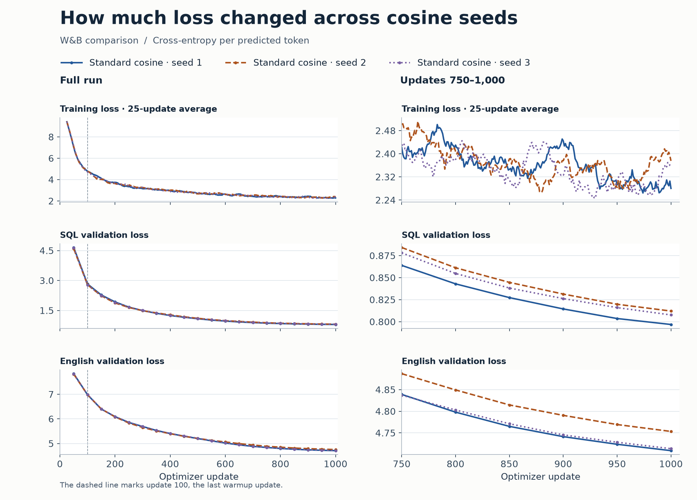

# Seed variation and learning-rate schedules in pretraining

Both warmup–stable–decay (WSD) runs finished with lower SQL and English validation loss than all
three standard cosine runs. WSD pulled ahead during the stable phase, and its final gains were
much larger than the spread across cosine seeds. The two WSD tails finished close enough that
either is a reasonable baseline for the next experiment.

## Question and prediction

We asked how much loss changes when we change the training seed, and whether holding the
learning rate high for longer helps at a fixed token budget. Before the run, we expected WSD
might sit higher during its stable phase, then catch up during decay. We recorded no numerical
prediction for the seed spread.

## Controlled settings

The five runs used the same 34.48M-parameter model, AdamW optimizer, dataset build, and budget
of 1,000 updates on one A10 per run. Every schedule warmed up for 100 updates to `6e-4` and
finished at `6e-5`. Standard cosine decayed immediately after warmup. WSD held `6e-4` through
update 800, then decayed over updates 801–1,000 with a linear or cosine tail. We tested standard
cosine with seeds 1, 2, and 3, and both WSD tails with seed 1.
[W&B comparison](https://forge.coreweave.com/wandb/dkbsingh7-iit-delhi/sqlgen-day7/runs/ap7dswze)

## Sanity checks

1. **Check the work done.** Each run completed 1,000 optimizer updates. Masked packing
   filled `8 × 4 × 4,096 = 131,072` input slots per update, so every run reached **131,072,000
   non-padding input tokens**. The loss uses fewer targets because packing masks document
   boundaries and next-token prediction shifts the labels.
2. **Check the schedule and the chart axis.** The logged LR followed the expected phases and
   endpoints. The raw W&B history for cosine seed 1 repeats updates 601–640 after its checkpoint
   resume. The published chart contains one point per optimizer update and uses the resumed
   trajectory.
3. **Keep validation comparable.** Each run evaluated the same 128 standalone document draws per
   corpus every 50 updates using validation seed 12345. Each corpus's loss weights its predicted
   tokens equally. Read training loss for the overall trajectory and use the fixed validation
   samples to compare runs.
4. **Check numerical stability.** All runs finished with finite logged losses and norms. The
   largest pre-clip gradient norms were **11.0–18.8 at updates 26–33**, during the shared
   warmup. With a threshold of 1.0, only 6–16 of the 900 updates after warmup triggered clipping
   per run. The histories show when the spikes occurred. Identifying their cause would require
   additional instrumentation.

The ten-update smoke run first checked that this workload fit and could resume. It peaked at
6.466 GiB allocated, restored from update 2, and finished with 1,310,720 input tokens. Its first
W&B verification saw seven updates. A fresh uncached query recovered all ten scalar rows and all
four chart tables.

## Results and interpretation

### When WSD pulled ahead

The seed-1 curves were close at the end of warmup. By update 200, both WSD runs were slightly
ahead of standard cosine seed 1 on both validation sets. The gap grew while WSD held its LR
steady. At update 800, WSD was about **0.09 lower on SQL** and **0.19 lower on English**. Both
WSD runs were already below the full three-seed cosine range.

At update 800, standard cosine was using `1.23e-4` while WSD was still at `6e-4`. The curves are
consistent with a higher LR helping the model make faster progress during this phase. During the
final 200 updates, all three seed-1 runs improved, and WSD widened its lead to about **0.13 on
SQL** and **0.30 on English**. Cooldown added to a lead that was already there. All five runs
reached their lowest observed validation losses at the last evaluation, so the conclusions apply
to this training budget.

The figures come from the published W&B comparison tables. Training traces use a 25-update
trailing average to make the trend visible. Validation markers are the original measurements.
[W&B chart source](https://forge.coreweave.com/wandb/dkbsingh7-iit-delhi/sqlgen-day7/runs/ap7dswze)

### How large was the seed spread?

| Run or statistic | Final SQL loss | Final English loss | Source |
| --- | ---: | ---: | --- |
| Standard cosine, seed 1 | 0.796816 | 4.708972 | [W&B](https://forge.coreweave.com/wandb/dkbsingh7-iit-delhi/sqlgen-day7/runs/822ec9a7a3db46d29f5ba7ae5152746e) |
| Standard cosine, seed 2 | 0.812063 | 4.753372 | [W&B](https://forge.coreweave.com/wandb/dkbsingh7-iit-delhi/sqlgen-day7/runs/d2de060b9c16451189ff44c2bd662fed) |
| Standard cosine, seed 3 | 0.807651 | 4.713550 | [W&B](https://forge.coreweave.com/wandb/dkbsingh7-iit-delhi/sqlgen-day7/runs/ae53e35464c94f38bed3c3b933277621) |
| **Cosine mean, n = 3** | **0.805510** | **4.725298** | |
| **Cosine sample std. dev., n = 3** | **0.007846** | **0.024420** | |
| WSD linear, seed 1 | 0.667811 | **4.403726** | [W&B](https://forge.coreweave.com/wandb/dkbsingh7-iit-delhi/sqlgen-day7/runs/9d013a624ebf457d9b54feb62540e7f0) |
| WSD cosine, seed 1 | **0.663367** | 4.406684 | [W&B](https://forge.coreweave.com/wandb/dkbsingh7-iit-delhi/sqlgen-day7/runs/6888a42b4d914085abfaf9fef0439e8e) |

Cosine seed 1 was the strongest cosine run on both validation sets. Against that same-seed
baseline, WSD lowered SQL loss by **0.129–0.133** and English loss by **0.302–0.305**. Even
twice the observed cosine standard deviation was much smaller, at **0.0157 on SQL** and **0.0488
on English**. This is a descriptive comparison with three cosine seeds and one run per WSD tail.
The seed changes both initialization and document sampling, and the seed-1 training losses began
to differ at update 2 under the same warmup schedule. Paired WSD runs with seeds 2 and 3 would
show how well the larger gain repeats.

The gap between the WSD tails was only **0.0044 on SQL**, favoring cosine decay, and **0.0030 on
English**, favoring linear decay. Those differences are small on the scale of the observed seed
spread. Both validation metrics measure next-token prediction on fixed samples. SQL execution
would give a separate measure of downstream quality. [Validation observations](validation_results.csv)

### The training mixture was more SQL-heavy than it looked

The sampler's `sql_fraction=0.50` gives SQL half the **document draws**. SQL contributed more
input tokens per draw after packing, so it accounted for about **62.7% of input tokens** in
every run. Between **76 and 93 updates per run** exceeded 70% SQL, and the highest single update
reached **80.3%**. That skew is a concrete reason to test a more English-heavy mixture. Compare
each corpus against its own baseline because SQL and English have different levels of token
predictability. [Document sampler](../../data/dataloader.py) ·
[W&B training histories](https://forge.coreweave.com/wandb/dkbsingh7-iit-delhi/sqlgen-day7)

## Next experiment

Use WSD linear as the reference and change only `sql_fraction` from `0.50`
to `0.40`. A sampler-only check can verify the estimate of roughly 53% SQL input tokens before
spending GPU time. Then match the seed and 131.072M input-token budget, track token and
loss-target shares, and compare the two validation losses. We expect English loss to improve
with more English exposure. The open question is how much SQL validation loss or held-out SQL
generation quality changes. One comparison arm takes about half an hour of A10 training, plus
evaluation and I/O.

## Sources

Pinned configuration and archived results

- The full suite completed 2026-11-22. The 34,478,592-parameter model had
  6 layers, width 512, FFN width 1408, 8 query heads and 4 KV heads, QK normalization disabled,
  and normal initialization with std. dev. 0.02. It used BF16 compute with FP32 parameters and
  optimizer state, masked packing, a 4,096-token context, microbatch 8, accumulation 4, and loss
  chunks of 128.
- AdamW used betas (0.9, 0.95), epsilon `1e-8`, weight decay 0.1, and gradient clip 1.0. WSD
  spent 10% of updates in warmup, 70% at the peak, and 20% decaying.
- Dataset path `/vol/bpe_tokenization/pretrain_data` on Modal volume `sqlgen-data`. SQL corpus
  ID `ff43d7752a904b649fad5b2d2dbb4df3`. Manifest SHA-256
  `914bb1a0fe4adfc52f474a5f4dccea636b16242ffdc0b2cfa14a02adab54501d`. The 32,768-token BPE
  tokenizer SHA-256 is `05b8bb66ea18f8328e785424de06fd6653c9147a7dbe686a4dd1627e224e85a1`. The
  English train and validation pools contain 9,238,968,483 and 1,026,673,344 tokens. The SQL
  pools contain 7,830,836,989 and 610,246,589 tokens.
- The Modal volume retains full histories in
  `/checkpoints/pretraining_experiments/day07/day07-full-2a6757d322c4/<case>/result.json`. The
  smoke run and its tracking recheck are in
  `/checkpoints/pretraining_experiments/day07/day07-smoke-073af7c11d79/`. The smoke W&B run ID
  was `004edebb74da49cdb7630d29e8bb0266` and was later deleted.
  [All 100 validation rows](validation_results.csv) ·
  [Published W&B comparison](https://forge.coreweave.com/wandb/dkbsingh7-iit-delhi/sqlgen-day7/runs/ap7dswze)

