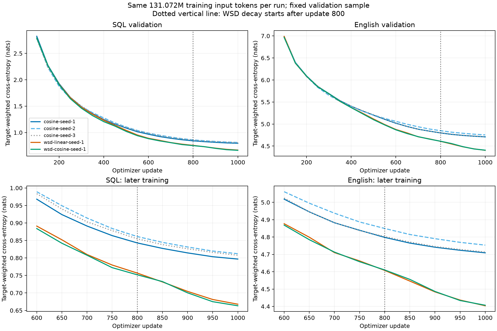
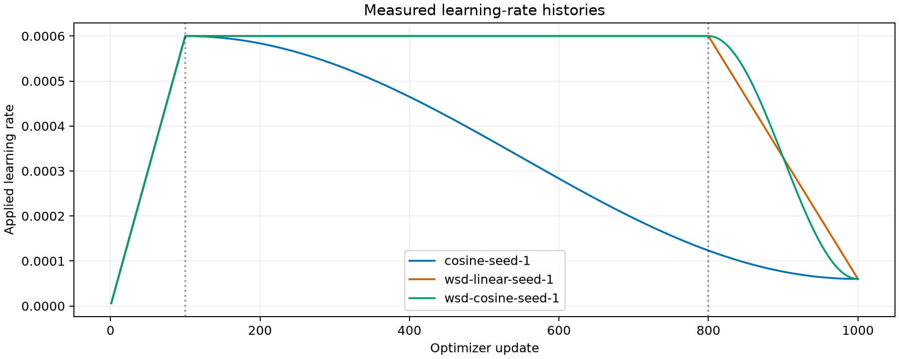

# Seed variation and learning-rate schedules: measured takeaways

Analysis of Experiment 7, completed 2026-11-22. Suite: `day07-full-2a6757d322c4`.

**Finding:** at 131.072M training tokens per run, both WSD schedules finished with
lower sampled SQL and English validation loss than all three cosine runs. The
WSD advantage was already present before the final decay. The two WSD tails
finished close together, with different winners for SQL and English. Repeated
seeds and a GPU determinism check are needed before making a strong causal claim.

## Question

1. How much do final losses vary when training seed changes under cosine?
2. At a fixed token budget, does WSD improve loss compared with continuous cosine decay?
3. Does the shape of WSD's final decay tail materially change the result?

These are retrieval-independent language-model pretraining measurements. They
measure next-token prediction loss, not SQL execution accuracy or schema retrieval.

## Prediction and what actually happened

The motivating prediction was that WSD might have higher loss during its stable
phase, then catch up or win during decay. That pattern was **not observed**:
at update 200 both WSD runs already had lower SQL and English loss than cosine
seed 1, and they remained below it at every subsequent evaluation. Both improved
further during decay, but the last 20% did not create the entire advantage.

No numerical seed-noise prediction was recorded before launch. Values such as
0.001, 0.01 and 0.05 in the original plan were prompts for a prediction, not
predictions that can now be claimed correct. We measure the spread below.

## Controlled settings and experimental validity

| Setting | Value |
| --- | --- |
| Model | 34,478,592 parameters; 6 layers; width 512; FFN 1408; 8 query / 4 KV heads; QK norm off |
| Initialization | Zero-mean normal, std 0.02; RMSNorm scales one; tied vocabulary output |
| Tokenizer/context | 32,768-token BPE; maximum sequence length 4096 |
| Layout | Masked packing; reset positions and mask cross-document attention/targets |
| Per-update batch | 8 sequences × 4096 slots × 4 accumulation = 131,072 slots |
| Training duration | 1000 optimizer updates per run |
| Training budget | 131,072,000 non-padding input tokens per run; 655,360,000 across five runs |
| AdamW | Peak LR 6e-4; floor 6e-5; betas (0.9, 0.95); eps 1e-8; decay 0.1; clip norm 1 |
| Numerics/hardware | One A10 per independent run; BF16 compute, FP32 parameters/state |
| Validation | Same 128 sampled standalone documents per corpus at every evaluation; validation seed 12345 |
| Evaluation frequency | Every 50 updates; 20 observations per corpus per run |
| Training seeds | Cosine: 1, 2, 3; WSD linear and WSD cosine: 1 |

Cosine warms up for updates 1–100, then decays through update 1000. WSD warms up
identically, holds 6e-4 through update 800, then decays over updates 801–1000.
The linear tail reaches 3.3e-4 at update 900; the cosine tail also reaches that
midpoint. Both reach 6e-5 at update 1000. Their rates differ between those points.

The coordinator's configuration/history checks pass for all five results: same
published build and controlled settings, complete updates 1–1000, expected
validation coordinates, finite logged metrics, and exactly 131,072,000 final
non-padding tokens each. Every final sampled loss was also that run's best
observed loss; the comparison therefore uses the same final checkpoint rather
than selecting different training budgets to favor particular runs.

The 50% SQL setting chooses **documents**, not tokens. The observed SQL token
fraction averaged 62.741% for each seed-1 run, 62.755% for cosine seed 2 and
62.783% for seed 3. This is consistent with SQL documents having different
lengths. Zero padding waste does not mean every input token is a prediction
target: shifted labels and document-boundary masking remove targets. Cumulative
predicted-target counts were not recorded, so the matched budget claim refers
to input tokens, not an exact matched number of loss targets across seeds.

### Dataset identity

- Published SQL corpus: `ff43d7752a904b649fad5b2d2dbb4df3`.
- Manifest identity: `914bb1a0fe4adfc52f474a5f4dccea636b16242ffdc0b2cfa14a02adab54501d`.
- Tokenizer SHA256: `05b8bb66ea18f8328e785424de06fd6653c9147a7dbe686a4dd1627e224e85a1`.
- Training pool: 9,238,968,483 English tokens and 7,830,836,989 SQL tokens.
- SQL completion manifest reports zero database-ID, repository and normalized
  query-hash overlaps. This is the preparation audit, not a claim that we have
  independently excluded every possible form of semantic leakage.
- The manifest identity hashes metadata; it is not a new checksum over all
  binary corpus bytes. Files were checked against published lengths/tokenizer.

## Measured results

Lower loss is better. Values are target-weighted next-token cross-entropy.

| Run | Final SQL loss | Final English loss |
| --- | ---: | ---: |
| [cosine-seed-1](https://forge.coreweave.com/wandb/dkbsingh7-iit-delhi/sqlgen-day7/runs/822ec9a7a3db46d29f5ba7ae5152746e) | 0.796816 | 4.708972 |
| [cosine-seed-2](https://forge.coreweave.com/wandb/dkbsingh7-iit-delhi/sqlgen-day7/runs/d2de060b9c16451189ff44c2bd662fed) | 0.812063 | 4.753372 |
| [cosine-seed-3](https://forge.coreweave.com/wandb/dkbsingh7-iit-delhi/sqlgen-day7/runs/ae53e35464c94f38bed3c3b933277621) | 0.807651 | 4.713550 |
| [wsd-cosine-seed-1](https://forge.coreweave.com/wandb/dkbsingh7-iit-delhi/sqlgen-day7/runs/6888a42b4d914085abfaf9fef0439e8e) | 0.663367 | 4.406684 |
| [wsd-linear-seed-1](https://forge.coreweave.com/wandb/dkbsingh7-iit-delhi/sqlgen-day7/runs/9d013a624ebf457d9b54feb62540e7f0) | 0.667811 | 4.403726 |

### Seed variation under cosine

Sample standard deviation uses denominator n−1 with **n=3 independent runs**.
It is variability between these completed runs, not a standard error per token.

| Metric | Mean | Sample std | 2 × sample std |
| --- | ---: | ---: | ---: |
| val/sql_loss | 0.805510 | 0.007846 | 0.015692 |
| val/english_loss | 4.725298 | 0.024420 | 0.048840 |

The SQL range is 0.015247 and the English range is 0.044399. Seed 1 happens to
be the best final cosine run for both metrics. Comparing WSD against seed 1
therefore does not compare against a particularly weak cosine outcome, although
one WSD seed is still insufficient to estimate WSD's own variation.

The seed changes initial weights and document sampling together. These data
cannot separate those two sources of variability, and GPU numerical variation
also contributes. A threshold of 2 × std is only a descriptive screening rule;
it is not a confidence interval or a formal significance test.

### Paired schedule differences, seed 1

| Comparison against cosine seed 1 | SQL loss reduction | English loss reduction |
| --- | ---: | ---: |
| WSD linear | 0.129005 (16.19%) | 0.305247 (6.48%) |
| WSD cosine | 0.133449 (16.75%) | 0.302289 (6.42%) |

These percentage reductions describe cross-entropy itself; they are not percent
improvements in SQL accuracy. On a perplexity scale, use exp(loss difference):
WSD reduces SQL perplexity by about 12.1–12.5% and English perplexity by about
26.1–26.3% relative to cosine seed 1. SQL and English loss magnitudes should not
be compared as if their document distributions had equal predictability.

WSD's gains are larger than cosine's descriptive 2 × std values for both corpora.
That supports prioritizing a replication of WSD, rather than dismissing the
observed gap as the typical cosine seed spread. It does **not** establish
significance: there are only three baseline seeds and one run of each treatment.

The overview panels start at update 100 and the detail panels at update 600.
All evaluations, including update 50, are retained in the linked CSV.

## Curve analysis: where did the advantage appear?

| Update | Cosine SQL | Cosine English | WSD linear SQL | WSD linear English | WSD cosine SQL | WSD cosine English |
| --- | ---: | ---: | ---: | ---: | ---: | ---: |
| 100 | 2.8249 | 6.9827 | 2.7922 | 6.9892 | 2.7915 | 6.9651 |
| 200 | 1.9268 | 6.0925 | 1.9135 | 6.0845 | 1.9066 | 6.0878 |
| 400 | 1.2456 | 5.4052 | 1.2320 | 5.3742 | 1.2064 | 5.3733 |
| 600 | 0.9680 | 5.0184 | 0.8911 | 4.8766 | 0.8840 | 4.8686 |
| 800 | 0.8429 | 4.7980 | 0.7567 | 4.6076 | 0.7519 | 4.6102 |
| 850 | 0.8273 | 4.7651 | 0.7315 | 4.5461 | 0.7325 | 4.5559 |
| 900 | 0.8145 | 4.7413 | 0.7045 | 4.4837 | 0.7004 | 4.4863 |
| 950 | 0.8036 | 4.7237 | 0.6813 | 4.4366 | 0.6751 | 4.4339 |
| 1000 | 0.7968 | 4.7090 | 0.6678 | 4.4037 | 0.6634 | 4.4067 |

### Warmup, updates 1–100: a reproducibility warning

All three seed-1 runs have identical first-update loss (10.501765), identical
learning rates through update 100, and identical logged SQL token fractions at
**every one of the 1000 updates**. Their training losses first differ on update
2. At update 100 their SQL losses are already 2.824870, 2.792233 and 2.791509.
Likewise the two WSD runs differ before update 801, while their schedules match.

Matching seeds did not produce bit-identical GPU trajectories. The observed
sampling fractions support matching data selection but are not cryptographic
batch hashes. Non-deterministic GPU kernels/reduction arithmetic are plausible
causes; the logs do not isolate a cause or independently prove identical initial
state tensors. Do not explain a warmup gap as a schedule effect: the schedule
has not changed yet. A repeated same-seed run and an initial-state/batch hash
check are the appropriate next controls.

### Stable interval, updates 101–800: WSD is already ahead

By update 800, WSD linear leads cosine by 0.086189 SQL loss and 0.190351 English
loss. WSD cosine leads by 0.091082 and 0.187800. Those gaps represent about
**67–68% of the eventual SQL advantage and 62% of the eventual English advantage**.
The main separation therefore predates the tail.

A plausible explanation is that the continued larger learning rate supported
more progress at this model/data budget, while cosine reduced its rate earlier.
This is an interpretation consistent with the curves, not a measured mechanism.
The experiment compares complete schedules; it does not hold their integrated
learning rates or AdamW's cumulative shrinkage equal. Decoupled weight decay is
also multiplied by the LR, so a schedule change alters that exposure as well.

### Decay interval, updates 801–1000: additional improvement

Cosine seed 1 improves SQL by 0.046120 and English by 0.088988 during the last
200 updates. WSD linear improves by 0.088936 and 0.203884; WSD cosine by 0.088488
and 0.203476. WSD gains more in this interval, but all three curves continue to
improve. A visible decline during decay is consistent with the hypothesis;
calling the entire improvement a sudden final "hockey stick" would overstate it.

There is no clear overall winner between the WSD tails: cosine is lower on SQL
by 0.004445, while linear is lower on English by 0.002958. Those gaps are smaller
than the respective cosine sample standard deviations (0.007846 and 0.024420).
That is context rather than an equivalence test, since WSD's own variance is
unmeasured and the two runs had already drifted before their tails diverged.
We should not spend scarce compute declaring a tail winner from these results.

## Stability, throughput, and memory

| Run | Median useful tokens/sec, updates 101–1000 | Peak allocated GiB | Updates with pre-clip norm > 1 |
| --- | ---: | ---: | ---: |
| cosine-seed-1 | 70,639 | 6.467 | 87 / 1000 |
| cosine-seed-2 | 70,562 | 6.466 | 82 / 1000 |
| cosine-seed-3 | 69,962 | 6.466 | 78 / 1000 |
| wsd-cosine-seed-1 | 67,724 | 6.466 | 93 / 1000 |
| wsd-linear-seed-1 | 70,231 | 6.466 | 90 / 1000 |

All logged metrics were finite; there is no recorded numerical divergence.
Clipping happened on 7.8–9.3% of updates, mostly during warmup; only 6–16 updates
per run exceeded the clipping threshold after update 100. The logged norm is
before clipping. This does not show that larger untested LRs would be stable.

Timed training work sums to approximately 30.9–32.3 minutes per run. It excludes
startup/data indexing, validation, checkpoint IO, W&B and coordinator time, so
it is not billable duration. Cosine seed 1 also resumed from checkpoint 600
(as confirmed by its Modal startup logs). Work after that checkpoint was replayed;
its W&B update counter therefore briefly stepped backward. The saved result
history retains the resumed committed trajectory, not every attempted update.
Repeated compute is not included in the 1000-update token count or the timed
history sum above, so actual GPU cost cannot be reconstructed from that sum. The suite's persisted plan/summary timestamps span
approximately 39 minutes. The WSD-cosine worker was slower despite the same
model and workload: physical-device/runtime variation is plausible, not evidence
that calculating a cosine scalar materially slows model training.

## Limitations and practical decision

- Three cosine seeds and one seed per WSD schedule cannot establish a robust
  treatment variance or formal significance. Same-seed GPU drift weakens a
  strict paired causal interpretation.
- The same 128 documents per corpus are sampled repeatedly; 20 evaluations are
  not 20 independent test sets. No per-document losses or bootstrap intervals
  were saved. Reusing this sample for many future choices can overfit validation.
- Validation retains standalone document prefixes up to 4096 tokens. These
  metrics do not test full overlong prompts, long-context generation, or SQL execution.
- Training loss averages a changing mixture of sampled English/SQL documents;
  fluctuations in training loss alone are weaker evidence than fixed-sample
  validation. No claim of generalization follows from low training loss alone.
- Learning rate, token budget, architecture and optimizer are fixed here. Results
  do not prove WSD universally outperforms cosine or remains better at larger budgets.
- All runs' best observed validation losses occur at update 1000; none demonstrates
  a learning plateau. This does not prove how continued training would rank them.
- Reported history/chart verification confirms stored coordinates and table sizes,
  not a browser rendering inspection. No account billing total was recorded.

**Decision:** WSD is the promising schedule family for this configuration, and
linear decay is a reasonable simple candidate for a replication. Keep cosine
as the baseline for the planned batch/LR sweep so that experiment follows its
controlled design; changing both schedule and batch settings would mix questions.
The tiny tail differences do not justify picking a scientific winner yet.

## Next experiment, in priority order

1. First use saved metadata/logs; do not rerun all five just to redraw charts.
2. For reproducibility, compare initial-state hashes and per-update batch hashes,
   then repeat the same seed/config briefly. Measure same-seed GPU drift before
   attributing small gaps to a schedule. Deterministic settings, if introduced,
   need their own correctness/performance comparison.
3. If budget permits, add WSD linear seeds 2 and 3 against the existing cosine
   seeds; report individual paired differences. Then decide whether another tail
   comparison is worth its compute. A larger fixed validation sample can be
   evaluated from final checkpoints without retraining.
4. For the batch/LR study, preserve the agreed 131.072M tokens per case and cosine
   baseline, and cap the tested grid to the actual remaining budget before launch.
5. Mid-stable checkpoint branching remains untested. The existence of retained
   checkpoints is not evidence for WSD's "anytime stop" behavior.

## Evidence and reproduction

- [W&B comparison](https://forge.coreweave.com/wandb/dkbsingh7-iit-delhi/sqlgen-day7/runs/ap7dswze); individual run links are in the result table.
- [Validation observations](validation_results.csv): all 100 recorded evaluation rows.
- [Computed summary](measured_summary.json): full-precision seed statistics,
  controlled settings and data identity, recomputed from the saved result histories.
- Saved full histories: Modal volume `sqlgen-data`, under
  `/checkpoints/pretraining_experiments/day07/day07-full-2a6757d322c4/<case>/result.json`.
- Every case's persisted verification reports complete scalar history and chart
  tables. No new GPU training was launched to write this analysis.
