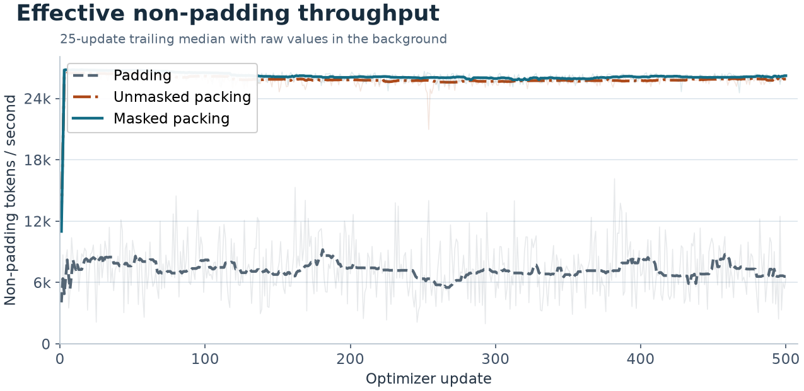
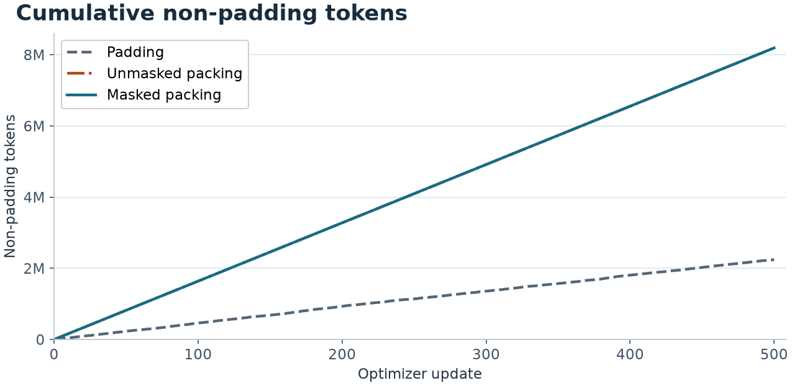
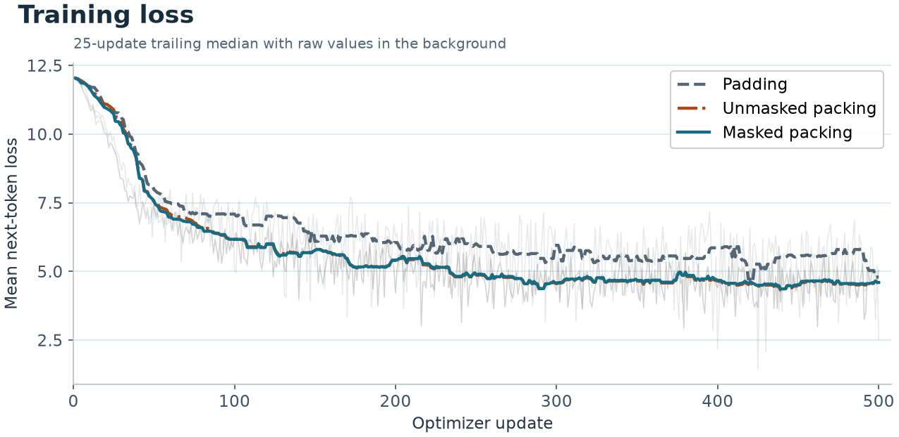
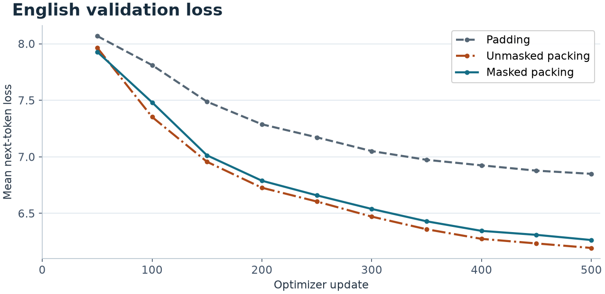
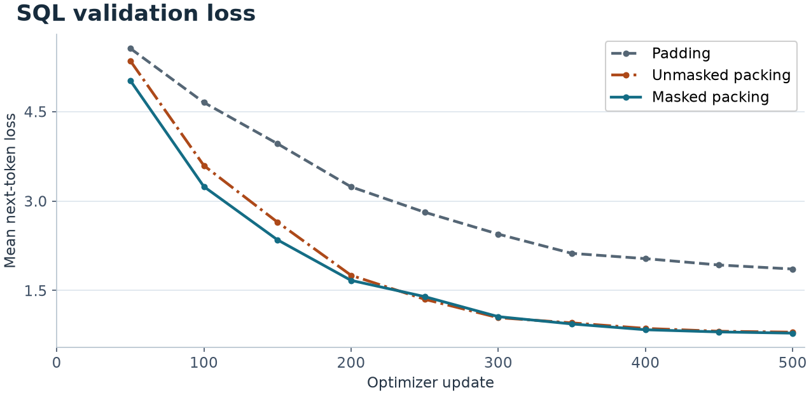

# Sequence packing: analytical takeaways

## Question

How much training work is lost to padding, and what happens when packed documents
can attend across their boundaries?

## Prediction

Packing should improve useful-token throughput by filling empty slots. Isolating
documents should preserve each document's attention and next-token boundaries.
This is the motivating hypothesis; these notes do not preserve a recorded
numerical prediction made before the historical run.

## Controlled settings

Three single-A10 runs: padding, unmasked packing, and masked packing. Each used
500 updates, seed 42, sequence length 2048, microbatch 4, accumulation 2, and the
original corpus/tokenizer. Evaluation used standalone documents. Changing layout
also changed the number of useful training tokens per update.

## Measured results

| Method | Median useful tokens/sec, updates 51–500 | Useful tokens seen | Final English loss | Final SQL loss |
| --- | ---: | ---: | ---: | ---: |
| [Padding](https://forge.coreweave.com/wandb/dkbsingh7-iit-delhi/sqlgen-day5/runs/fc6405f5e7e942d891b48e252d42f862) | 7,115 | 2.24M | 6.850 | 1.861 |
| [Unmasked packing](https://forge.coreweave.com/wandb/dkbsingh7-iit-delhi/sqlgen-day5/runs/cf71dfdbdb944981bdb146222ec884ff) | 25,811 | 8.19M | 6.194 | 0.802 |
| [Masked packing](https://forge.coreweave.com/wandb/dkbsingh7-iit-delhi/sqlgen-day5/runs/9803edfba7e04d539b9fd75588042232) | 26,104 | 8.19M | 6.264 | 0.786 |

## Explanation

Packed runs delivered approximately 3.6× the useful throughput of padding.
Masking boundaries had little observed throughput cost at this configuration.
The packed runs also saw 3.65× as many useful tokens at equal update counts.
Their lower validation loss combines increased data exposure and layout effects;
it does not isolate which part caused the improvement.

Training loss averages different sampled documents/targets across layouts.
Unmasked packing permits cross-document attention and predicts the next
document after EOS. Masked packing resets positions and masks that boundary
prediction. Standalone validation gives the methods a common evaluation task.

## Limitations

The original train/validation sets overlapped. These loss values describe that
historical experiment and do not establish generalization on the new audited
split. One seed per layout provides no seed-variance estimate. The small SQL
loss gap between the packed methods is not evidence of a reliable winner.
Memory/throughput on the original corpus is not a guarantee at 4096 with 32K BPE.

## Next experiment

Use the current audited build, a shared fixed validation sample, multiple seeds,
and matched useful-token budgets. Compare masking's effect separately from the
throughput benefit of filling padding slots.
