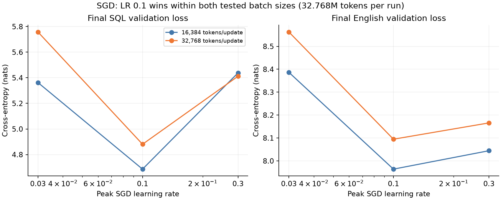
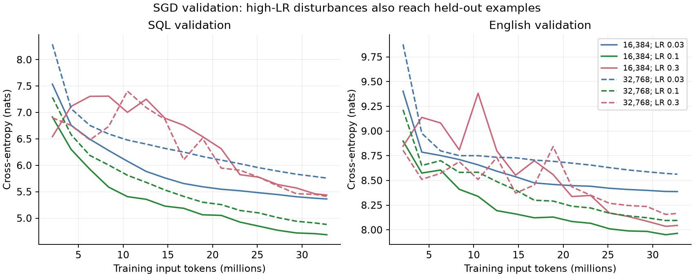
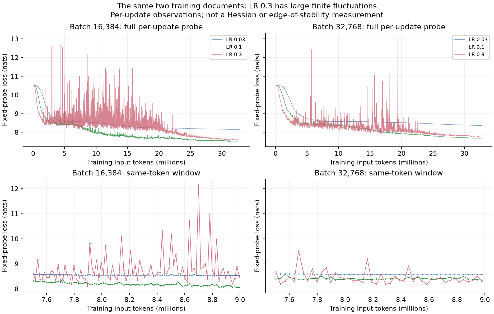
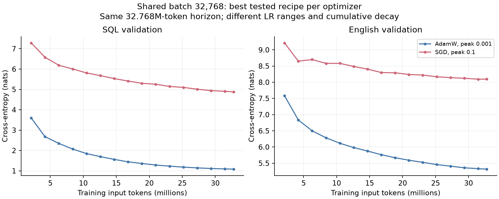

# SGD stability and the AdamW comparison: measured takeaways

**SGD's best tested LR was `0.1` at both batch sizes. Raising it to `0.3`
hurt final SQL and English loss and produced large, repeated fluctuations on
identical training examples.** This screen therefore found a useful LR bracket,
unlike the earlier AdamW screen whose highest LR kept winning.

At the shared batch of **32,768**, the best tested AdamW recipe still learned
much more effectively: final SQL loss **1.082814**, versus **4.880735** for SGD.
That is a recipe comparison at a matched horizon, not proof that SGD is always
inferior: clipping was almost continuously active in SGD, and its much higher LR
also imposed much stronger cumulative shrinkage at the fixed decay coefficient.

All six SGD runs completed. This report analyzes existing results; it launches
no new training, branches or curvature jobs.

## Question

When batch decreases from 32,768 to 16,384, does its extra update frequency
outweigh noisier gradients? How does the preferred LR change, when does higher
LR hurt, and do we now have observable fluctuations and saved states suitable
for the next branching lesson? At the common batch size, how do the tested SGD
recipes compare with the completed AdamW recipes?

## Predictions and what actually happened

| Prediction made before launch | Measured outcome |
| --- | --- |
| LR `0.03` may be conservative. | It finished worse than `0.1` in both corpora at both batches. |
| `0.1` or `0.3` may learn faster or become less stable. | `0.1` was best tested; `0.3` had much larger fixed-probe fluctuations and worse final loss. No run became nonfinite. |
| Clipping may suppress the behavior we hope to study. | Clipping activated on 99.6–100% of updates, yet sizeable fluctuations remained at `0.3`. What would happen without clipping was not tested. |
| Smaller batch may encounter trouble sooner. | Its matched-token probe fluctuations were larger in the early post-warmup window. Final-loss results did not show a consistent winner reversal across both corpora. |

We obtained more informative dynamics than the AdamW screen, but did **not**
measure a Hessian spectrum or establish an edge of stability.

## Controlled settings

| Setting | SGD batch 16,384 | SGD batch 32,768 |
| --- | ---: | ---: |
| Context length | 4,096 | 4,096 |
| Hardware microbatch, sequences | 4 | 4 |
| Accumulation | 1 | 2 |
| Optimizer updates | 2,000 | 1,000 |
| Warmup updates | 200 | 100 |
| Warmup input tokens | 3,276,800 | 3,276,800 |
| Total input tokens | 32,768,000 | 32,768,000 |
| Valid prediction targets, measured | 32,736,263 | 32,736,263 |
| Peak LRs | `0.03`, `0.1`, `0.3` | `0.03`, `0.1`, `0.3` |

Both batches consumed 2,000 microbatches. All cases began fresh at seed 1 with the
same 34,478,592-parameter Transformer: 6 layers, width 512, FFN 1408, GQA 8/4,
QK norm off, initialization std 0.02, masked packing, BF16 compute/FP32 weights.
Cosine followed 10% warmup and ended at 10% of each peak. The LR schedule was
aligned by tokens across batches. Gradient clipping remained **1.0** and
**decoupled weight decay 0.1** applied to matrices; norms received no decay.
There was no momentum or adaptive gradient scaling in this SGD implementation.

The optimizer is explicitly `DecoupledSGD`, not ordinary PyTorch SGD with coupled
L2 regularization. Its decay placement matches AdamW's. The same coefficient
and placement do not imply the same total regularization across LR ranges.

Validation seed 12345 selected 128 standalone documents per corpus. All runs had
16 observations per corpus at the same training-token coordinates, every
2,097,152 tokens plus the final budget. Training SQL probability remained 0.5
by document, yielding **62.8345% SQL tokens**, exactly as in the AdamW screen.
The original 50/50-by-token curriculum suggestion was not a new mixture variable.

### What was checked

The saved histories passed the existing analyzer and reproduced the suite's
numeric results exactly: six cases, finite contiguous histories, equal final
budgets and matching validation coordinates. All six W&B training runs and the
comparison run are finished, and every saved uploaded-history/chart check passed.
There are **96 SGD validation observations and 9,000 per-update probe observations**.

Within each LR, the large-batch target and SQL-token counts matched pairs of
small-batch updates. At batch 32,768, SGD also matched AdamW's per-update target
counts and SQL fractions. Training configurations differed only in optimizer and
peak/minimum LR; diagnostic instrumentation was added to SGD separately. The
common dataset identity was verified. This is strong exposure/accounting evidence,
not a token-by-token equality test or a claim of bit-identical GPU arithmetic.

## Final matched-budget results

Loss is token-weighted next-token cross-entropy in nats; lower is better. These
are final values at **32.768M input tokens**, not best checkpoints selected at
unequal exposures. Unlike the AdamW screen, the final checkpoint was not always
the minimum observed English validation loss.

| Batch | Peak SGD LR | Final SQL loss | Final English loss | Status |
| ---: | ---: | ---: | ---: | --- |
| 16,384 | 0.03 | 5.362884 | 8.386724 | Completed |
| **16,384** | **0.1** | **4.686303** | **7.964052** | **Completed** |
| 16,384 | 0.3 | 5.437961 | 8.044377 | Completed |
| 32,768 | 0.03 | 5.758083 | 8.562848 | Completed |
| **32,768** | **0.1** | **4.880735** | **8.094679** | **Completed** |
| 32,768 | 0.3 | 5.411802 | 8.165766 | Completed |



### We bracketed a better region; higher LR stopped being better

For batch 16,384, `0.03 → 0.1` improved SQL loss by **0.676581**, but
`0.1 → 0.3` worsened it by **0.751658**. For batch 32,768, the corresponding
improvement and penalty were **0.877348** and **0.531067**. English loss also
preferred `0.1` at both batches.

Thus `0.1` is an **interior grid winner**. This brackets a promising region more
usefully than a boundary winner, but three widely spaced rates do not identify
the exact optimum. A rate between these values could still win. In particular,
the preferred LR did not shift between these two batches on this grid.

### The batch effect depends on LR and which metric we inspect

Positive differences below mean the larger batch was worse.

| Peak SGD LR | SQL loss, 32,768 minus 16,384 | English loss difference |
| ---: | ---: | ---: |
| 0.03 | +0.395199 | +0.176124 |
| 0.1 | +0.194433 | +0.130627 |
| 0.3 | −0.026158 | +0.121388 |

At the best tested LR, the smaller batch's extra updates won in both corpora.
At `0.3`, the larger batch had slightly lower SQL loss but still worse English
loss. The SQL difference of 0.026158 has no matched-seed uncertainty estimate.
This is **not a robust crossover in overall quality**, nor evidence that a critical
batch boundary has been located. It does show why a single-LR, single-metric
statement such as “smaller batch always wins” would be too broad.



## Did we observe oscillations?

**We observed repeated finite rises and falls on a fixed training probe,
especially at LR `0.3`.** Changing training examples cannot by itself explain
that curve: every probe evaluated the same saved token IDs and masks after each
update. However, the stochastic training batches still drive the changing
weights. The data do not establish a periodic cycle around one minimum or a
Hessian-based edge-of-stability mechanism.

The probe consisted of one English document with **1,255 valid targets** and
one SQL document with **77**. Its combined loss was therefore **94.22% weighted
toward English**. The probe fingerprint matched across all six runs. It is a
consistent but small, English-heavy diagnostic, not a representative estimate
of whole-training-set sharpness. Separate SQL validation provides corroborating
SQL evidence; the probe alone should not be called a SQL oscillation measure.



### Quantify amplitude, not just the number of upward steps

Counting increases alone is misleading: even `0.03` had many tiny upward steps
while making useful progress. To compare batches at equal exposure, we sampled
probe loss every **32,768 tokens** and calculated:

```text
RMS successive change = sqrt(mean((loss[i] - loss[i-1])²))
```

The early window was **10% < tokens ≤ 50%** of the budget, after warmup; each
case supplied 400 observations and 399 differences. The late window was the
last 10% of tokens. This statistic includes drift as well as fluctuations; it
is not gradient-noise scale, curvature or an oscillation significance test.

| Batch | Peak LR | Early RMS change | Late RMS change | Largest rise across one actual update |
| ---: | ---: | ---: | ---: | ---: |
| 16,384 | 0.03 | 0.009013 | 0.001222 | 0.048834 |
| 16,384 | 0.1 | 0.061745 | 0.008898 | 0.598336 |
| 16,384 | 0.3 | **0.773622** | 0.011670 | **4.083954** |
| 32,768 | 0.03 | 0.004895 | 0.001055 | 0.010147 |
| 32,768 | 0.1 | 0.047791 | 0.003677 | 0.322670 |
| 32,768 | 0.3 | **0.555415** | 0.015839 | **4.324947** |

At `0.3`, the early matched-token change was roughly **13× / 12×** that at
`0.1` for the smaller/larger batch. For each LR, the smaller batch had larger
early-window changes, consistent with more variable trajectories; this does not
isolate gradient noise from update frequency, decay or different learned states.

Fluctuations became much smaller late in the run as cosine reduced LR. That is
consistent with LR-sensitive dynamics, but time, learned state and cumulative
decay changed together. A controlled reduced-LR branch is still needed to test
whether lowering LR at the *same state* dampens the fluctuations.

Validation also fluctuated: SQL loss rose on **4 of 15** successive evaluations
at batch 16,384/`0.3` and **3 of 15** at batch 32,768/`0.3`. The corresponding
English counts were **5/15** and **6/15**. At `0.03` both validation series were
monotone decreasing; at `0.1` SQL remained monotone while English rose 3/15 times
at each batch. These distinguish moderate fluctuations from the large high-LR
disturbances. All six runs remained numerically finite.

## Clipping, weight decay and actual update size

| Batch | Peak LR | Updates clipped | Median pre-clip norm | Maximum pre-clip norm |
| ---: | ---: | ---: | ---: | ---: |
| 16,384 | 0.03 | 100% | 3.058 | 9.473 |
| 16,384 | 0.1 | 100% | 4.047 | 20.619 |
| 16,384 | 0.3 | 100% | 4.817 | 281.647 |
| 32,768 | 0.03 | 99.6% | 3.042 | 7.996 |
| 32,768 | 0.1 | 100% | 2.860 | 12.341 |
| 32,768 | 0.3 | 100% | 4.873 | 59.307 |

These SGD runs operated almost entirely in the **clipped-gradient regime**.
The gradient contribution to the step was approximately an LR-scaled normalized
gradient direction. Larger LR could still make that contribution larger; clipping
at 1.0 did not make `0.3` behave like `0.1`. The large pre-clip norms describe
steep/noisy gradients, not a direct curvature measurement.

Decay is outside the clipped gradient. At batch 32,768's warmup end, the actual
whole-parameter update norms were **0.304955 / 0.720958 / 0.843212** for peak
LRs `0.03 / 0.1 / 0.3`. They exceeded the gradient-only bounds of `0.03 / 0.1 /
0.3` because shrinkage contributed too. These were computed from saved actual
parameter-difference tensors, not inferred from gradient norm.

As a second check, `||update|| / ||post-update parameters||` at the midpoint was
**0.0782% / 0.0771% / 0.2337%** for the same three batch-32,768 cases. This uses
the whole parameter norm at the saved state, including non-decayed norm weights;
it is not a layerwise stability limit or an equivalent of a Hessian eigenvalue.

## AdamW versus SGD: compare the shared batch, not unrelated rows

Only **batch 32,768** overlaps the two sweeps. Both used the same 32.768M-token
horizon, seed, data, 1,000 updates, clipping/decay coefficients and cosine schedule.
AdamW was searched at `1e-4/3e-4/1e-3`; SGD at `0.03/0.1/0.3`. Different LR
ranges are appropriate because their update rules have different scales.

| Optimizer, batch 32,768 | Peak LR | Final SQL loss | Final English loss |
| --- | ---: | ---: | ---: |
| AdamW | 0.0001 | 2.197655 | 6.400445 |
| AdamW | 0.0003 | 1.536814 | 5.788605 |
| **AdamW, best tested** | **0.001** | **1.082814** | **5.316530** |
| SGD | 0.03 | 5.758083 | 8.562848 |
| **SGD, best tested** | **0.1** | **4.880735** | **8.094679** |
| SGD | 0.3 | 5.411802 | 8.165766 |

The best-tested SGD recipe was worse by **3.797922 SQL loss** and **2.778149
English loss**. Every tested AdamW recipe beat every tested SGD recipe at this
batch. There was no SQL-versus-English winner conflict in that comparison.
These are cross-entropy differences, not execution-accuracy percentages.



### Why this does not isolate optimizer adaptation alone

AdamW's momentum and adaptive per-coordinate scaling can help a short run make
progress differently from clipped plain SGD. The data support that AdamW's tested
recipe worked better here; they do not separately identify the benefit of each
component. Three additional restrictions matter:

1. **Cumulative decay was very different.** The decay-only multiplier
   `product(1 - lr_t × weight_decay)` for the best tested recipes was **0.946952**
   for AdamW, versus **0.004209** for SGD at the same batch. SGD `0.3` had a
   multiplier of **6.60e-8**; at batch 16,384 it was **4.37e-15**. These are
   shrinkage-only calculations, not the actual final weight norms: gradients keep
   adding learned signal. Keeping coefficient 0.1 at much higher LR changes the
   regularization budget substantially. The high-LR loss penalty cannot be
   attributed solely to overshooting or noise.
2. **Clipping acted very differently.** AdamW's best-tested batch-32,768 run
   clipped 10.6% of updates, versus 100% for the SGD winner. These compare different
   optimization regimes as well as different optimizers.
3. **The LR searches have different resolving power.** SGD had an interior winner;
   AdamW still won at its upper boundary. Neither sweep locates an exact optimum,
   and one seed is not a statistical optimizer ranking.

No AdamW case exists at batch 16,384 in these completed screens. Likewise,
AdamW did not record this fixed probe, so we cannot compare fixed-probe amplitudes
between optimizers retrospectively. Its raw training-loss jaggedness is not an
interchangeable diagnostic.

## Time efficiency

Training-update time, reconstructed from recorded throughput, was **8.15–8.81
minutes per SGD run**. It excludes fixed-probe forwards, validation, checkpoint
IO and logging. At batch 32,768, mean SGD update time was **8.210 minutes** versus
AdamW's **8.280 minutes**: under a 1% reduction, alongside much worse validation
loss. There is no compelling time-to-quality advantage in this screen.

SGD's mean update time at batch 16,384 was **8.414 minutes**, about 2.5% above
batch 32,768. Actual W&B SDK lifetimes ranged from **671 to 761 seconds**. The
smaller batch made twice as many per-update probe evaluations, so total-runtime
comparisons include diagnostic workload differences. SDK lifetime is not a Modal
billing export or complete container lifetime; no exact dollar spend is inferred.

## What we can decide now

- **Provisional quality candidate:** retain AdamW, batch 32,768, peak `1e-3` from
  the tested recipes. Its upper LR boundary remains worth investigating before
  calling the recipe optimized.
- **Provisional SGD candidate:** batch 16,384, peak `0.1`, if comparing SGD recipes
  at this horizon. Both batches prefer `0.1`; there is no measured LR-optimum shift.
- **Dynamics candidate:** SGD peak `0.3`, particularly batch 16,384's early
  post-warmup trajectory, supplies observable fixed-probe fluctuations and saved
  state for a branching test. It is not the quality winner.
- **No EoS claim yet:** repeated finite loss movements and LR sensitivity provide
  motivation, not a measurement of curvature or proximity to a stability boundary.

## Limitations

One seed per cell means no seed mean, sample standard deviation or significance
estimate is available. Do not estimate seed uncertainty from LR variation or
correlated update histories. The probe has only two training documents and is
English-heavy; validation also reuses a small sample selected during tuning.
No held-out-schema SQL execution accuracy was measured. The two SGD batch sizes
and three LRs cannot locate a universal critical batch or exact optimal LR.

The cosine LR changes throughout post-warmup training; late smoothing alone is
not a controlled LR experiment. Clipping, decay, stochastic batches and changing
parameter scales limit any direct use of the full-batch, unclipped GD `2/eta`
sharpness intuition. Neither Hessian eigenvalues, gradient-noise scale, nor a
controlled original-LR/reduced-LR branch was measured in this sweep.

## Next experiment: use the saved unstable-looking trajectory carefully

A concrete starting point is **SGD, batch 16,384, peak `0.3`, update 500**:
8.192M tokens, still in the early post-warmup high-LR region. The retained
`step-000500.pt` and saved fixed probe exist. Fork that **same state**, optimizer
and future RNG stream into an original-cosine-LR continuation and a reduced-LR
continuation. Predeclare an equal future-token window and compare fixed-probe
amplitude, validation loss, clipping and actual update size.

That tests LR sensitivity. Because LR also scales decoupled shrinkage, a mechanistic
claim about gradient-step stability should track or separately control that
shrinkage. A separate directional-curvature/Hessian probe would address the
stronger edge-of-stability claim. **These are proposals; no branches were launched.**

For optimizer selection, either refine SGD around its interior winner or add the
missing AdamW batch-16,384 row with an optimizer-appropriate LR bracket. An
optimizer-only explanation also needs regularization/clipping sensitivity checks;
any changed controls must be explicit and held fixed within the new comparison.
Confirm finalists at the intended full horizon and matched additional seeds before
spending on a large-model transfer.

## Checkpoint and evidence inventory

The existing folder structure is preserved. Modal artifacts live under:

```text
/vol/checkpoints/pretraining_experiments/sgd_stability/sgd-stability-87b9a2c0cec8/
```

`plan.json` indexes retained milestones **1/200/500/1000/2000** for batch 16,384
and **1/100/250/500/1000** for batch 32,768. Every case has `fixed_probe.pt`, all
five indexed snapshots, latest state, settings, raw metrics and result JSON.
Full snapshots include model/optimizer/config, data identity, sampler and CPU/CUDA
RNG, token count, history, probe recipe and actual last-update directions.

CPU inspection of all six warmup and midpoint states confirmed nonzero directions
covering **34,478,592 parameters**, along with the expected probe recipes. All
fixed-probe fingerprints matched; each probe had 1,255 English and 77 SQL targets.
The snapshots are about 276 MB each. Ordinary resume still rejects changed LR
settings; explicit branching support remains to be implemented.

Local report evidence:

- [Analysis, diagnostics, sanity checks and checkpoint inventory](analysis.json)
- [96 validation observations](validation_results.csv)
- [9,000 per-update fixed-probe, training-loss, gradient and clipping observations](probe_history.csv)
- [Per-run loss, timing, clipping, fluctuation and decay diagnostics](run_diagnostics.csv)
- [Earlier AdamW takeaways](../batch_lr_scaling/takeaways.md) and [numeric evidence](../batch_lr_scaling/analysis.json)
- [SGD W&B comparison](https://forge.coreweave.com/wandb/dkbsingh7-iit-delhi/sqlgen-sgd-stability/runs/2s4iue0i)
- [AdamW W&B comparison](https://forge.coreweave.com/wandb/dkbsingh7-iit-delhi/sqlgen-batch-lr-scaling/runs/6zswayk3)
- [SGD Modal training app](https://modal.com/apps/sanika-05/main/ap-B1GHVIqksTcw8F6FyDf2Gk)

| Batch | Peak SGD LR | Source run |
| ---: | ---: | --- |
| 16,384 | 0.03 | [W&B](https://forge.coreweave.com/wandb/dkbsingh7-iit-delhi/sqlgen-sgd-stability/runs/abdd01c0529843c6ad0420a982c9c725) |
| 16,384 | 0.1 | [W&B](https://forge.coreweave.com/wandb/dkbsingh7-iit-delhi/sqlgen-sgd-stability/runs/d5ed167ebc7645e980d64f35083fe659) |
| 16,384 | 0.3 | [W&B](https://forge.coreweave.com/wandb/dkbsingh7-iit-delhi/sqlgen-sgd-stability/runs/e7b6787042cb4017ac0b26e0810ea254) |
| 32,768 | 0.03 | [W&B](https://forge.coreweave.com/wandb/dkbsingh7-iit-delhi/sqlgen-sgd-stability/runs/a1bb6e96c1d243a99ee4326d472eea87) |
| 32,768 | 0.1 | [W&B](https://forge.coreweave.com/wandb/dkbsingh7-iit-delhi/sqlgen-sgd-stability/runs/9b5b46855ab84221a47ac8f0b9074f48) |
| 32,768 | 0.3 | [W&B](https://forge.coreweave.com/wandb/dkbsingh7-iit-delhi/sqlgen-sgd-stability/runs/494996e9c9954b199f80ab360fa686cb) |

SGD suite: `sgd-stability-87b9a2c0cec8`; AdamW suite: `batch-lr-bfd9633ebee9`.
Corpus ID: `ff43d7752a904b649fad5b2d2dbb4df3`.
Manifest SHA256: `914bb1a0fe4adfc52f474a5f4dccea636b16242ffdc0b2cfa14a02adab54501d`.
Tokenizer SHA256: `05b8bb66ea18f8328e785424de06fd6653c9147a7dbe686a4dd1627e224e85a1`.
All results used the same completed flat-layout dataset and vocabulary 32,768.

## Completed checkpoint investigation

The [loss-landscape and branching follow-up](../loss_landscape/takeaways.md) has
now been measured. It retains clipping 1.0 and omits clipping-frequency analysis.
Two 200-update arms from the same peak-0.3/update-500 state consumed verified
identical future inputs. Constant LR 0.1 reduced probe fluctuation amplitude and
improved validation relative to constant 0.3. Four FP32 slices and bounded
probe-Hessian estimates are recorded with their numerical and theoretical limits.
This is local LR-sensitivity evidence, not an established edge-of-stability result.
